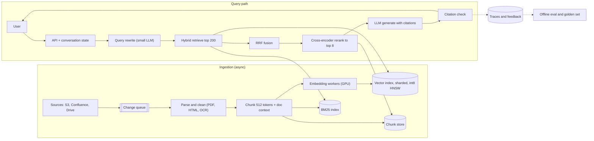

# Design RAG over 100M documents

[All designs](../README.md#the-15-designs) · [Answer framework](../framework.md) · [Numbers to know](../numbers.md)

**Difficulty:** Hard · **Key trade-off:** recall vs cost of the index and the prompt · **Round length:** 45 min

> All numbers here are back-of-envelope estimates with the assumptions written out. Swap in the interviewer's numbers and redo the math out loud. That is the skill being tested.

## Problem statement

"Design a question-answering system over 100 million internal documents. Users ask questions in natural language and get an answer with citations." (Representative prompt.)

This is the most common AI system design prompt. At 100M documents it stops being a LangChain tutorial and becomes an information retrieval and capacity problem. Most candidates spend 30 minutes on prompts. Spend them on retrieval quality, index size and how you will know the answers are right.

## Clarifying questions

Ask these first, then state your assumptions and move on.

| Question | Why it matters | Assumption for this answer |
|---|---|---|
| What are the documents? PDFs, HTML, tickets, code? | Parsing cost and chunking strategy | Mixed PDFs and HTML, average 5 pages |
| How fast do they change? | Index freshness design | 1% change per day, new docs visible within 15 min |
| Who are the users and how many queries? | Serving capacity | 10M queries/day, peak 3x average |
| Do all users see all documents? | Permission filtering at retrieval | Yes for this round. Per-user ACLs are [design 02](02-enterprise-search-with-permissions.md) |
| Latency target? | Reranker and model choice | First token under 1.5 s p95 |
| Languages? | Embedding model choice | English plus 5 major languages |
| Must answers cite sources? Can it say "I don't know"? | Grounding and refusal design | Yes to both |

## Requirements

**Functional**
- Ask a question, get a grounded answer with inline citations to document chunks.
- Follow-up questions in the same conversation.
- New and edited documents become searchable within 15 minutes.
- Refuse or say "not found" when retrieval finds nothing relevant.

**Non-functional (targets, not measured)**
- Retrieval p99 under 300 ms. Time to first token p95 under 1.5 s. Full answer p95 under 6 s.
- Availability 99.9%.
- Answer faithfulness above 95% on the golden set (every claim supported by a cited chunk).
- Recall@50 above 90% on the retrieval eval set.

## Back-of-envelope estimates

All estimates. Show each step.

**Corpus size**
1. 100M docs × 5 pages × ~500 words/page = 250B words.
2. At ~0.75 words per token, that is ~330B tokens.
3. Chunk at 512 tokens with ~10% overlap: 330B / ~460 new tokens per chunk ≈ **~700M chunks**.

**Vector index**
1. 1,024-dim float32 embedding = 4 KB per chunk. 700M × 4 KB ≈ **2.8 TB** raw.
2. int8 scalar quantization: 1 KB each, ≈ **700 GB**.
3. Binary quantization: 128 bytes each, ≈ **90 GB**, used only as a first pass with rescoring.
4. HNSW graph links at M=32: roughly 64 neighbors × 4 bytes on the base layer ≈ 256 bytes per vector ≈ **180 GB** more.

So the int8 index plus graph is about 900 GB. That fits in RAM across ~15 shards of 64 GB each, times 2 to 3 replicas. It does not fit on one box, which is why sharding comes up.

**Chunk text store**
700M chunks × ~2 KB of text ≈ **1.4 TB**, in a key-value store keyed by chunk ID.

**One-time embedding cost**
1. 330B tokens through a hosted embedding API at $0.02 to $0.13 per 1M tokens ≈ **$7k to $43k**. Check current pricing.
2. Self-hosted, assume a ~300M-param embedding model does ~50k tokens/s per GPU (estimate, varies with batch and sequence length): 330B / 50k ≈ 6.6M GPU-seconds ≈ **1,800 GPU-hours**. 100 GPUs finish in under a day.

**Ongoing ingest**
1% of 100M = 1M docs/day ≈ **12 docs/s**, about 85 chunks/s. Small. Freshness is a pipeline-latency problem, not a throughput problem.

**Query load**
1. 10M queries/day / 86,400 ≈ **115 QPS** average, **~350 QPS** peak.
2. Each query: ~4K tokens of retrieved context + ~500 system/history + ~400 output.
3. Input: 10M × 4.5K = **45B tokens/day**. Output: 10M × 400 = **4B tokens/day**.
4. At $0.15 to $3 per 1M input tokens, input alone is **$7k to $135k per day**. Check current pricing.

That last number is the one to say out loud. Generation, not the index, dominates the cost. The biggest cost levers are fewer and better chunks in the prompt, prompt caching for the shared prefix, and a smaller model for easy questions.

## Architecture

## Component walkthrough

**Parsing.** Most RAG quality problems start here. PDFs with tables, headers and two-column layouts parse badly with naive text extraction. Use a layout-aware parser for PDFs and keep table structure as Markdown. Keep the document title, section path and date with every chunk. Budget OCR only for scanned pages, which you detect by a low text-to-page ratio.

**Chunking.** 512 tokens with overlap is a sane default, not a law. Split on structure first (headings, paragraphs), then by length. Prepend a short context line to each chunk before embedding: the doc title, section and one sentence on what the doc is about. Anthropic reported that this "contextual retrieval" cut retrieval failures by 49%, and by 67% with reranking added ([source](https://www.anthropic.com/news/contextual-retrieval)). Generating that context costs one cheap LLM call per chunk, about 700M calls, so price it and say whether prompt caching of the document makes it affordable.

**Embedding.** Pick a multilingual model with 768 to 1,024 dims. Matryoshka-style models let you store truncated vectors (256 dims) for the first pass and full vectors for rescoring. Version the embedding model in every vector's metadata. Changing models means a full re-embed, which is the ~1,800 GPU-hour job above, so you run it as a backfill into a new index and switch over with a dual-read period.

**Vector index.** At 700M vectors you choose between:
- In-memory HNSW with int8 vectors, sharded by chunk ID hash. Fast (single-digit ms per shard), expensive in RAM.
- IVF-PQ, which compresses to ~64 bytes per vector. Cheap, lower recall unless you rescore with full vectors.
- DiskANN-style graph on SSD with compressed vectors in RAM. Close to HNSW recall at a fraction of the RAM, a few ms slower.

Every query fans out to all shards and merges top-k. Hash sharding keeps shards balanced. Sharding by tenant or topic makes queries cheaper but creates hot shards.

**BM25.** Dense retrieval misses exact tokens: product codes, error strings, names, acronyms. Run BM25 in parallel and fuse with Reciprocal Rank Fusion (RRF), which needs no score calibration. This is the cheapest quality win in the whole design.

**Query rewrite.** Turn "what about the EU one?" into a standalone query using the chat history. A small model is enough. For complex questions, split into sub-queries and retrieve for each.

**Reranking.** Retrieve 200 candidates, rerank with a cross-encoder, keep the top 5 to 10. The cross-encoder reads query and chunk together, so it is far more precise than cosine similarity. Cost: 200 pairs × ~600 tokens per query. On a GPU this is 50 to 150 ms (estimate). Rerank is where most of the precision comes from.

**Generation.** Put the system prompt and instructions first, then retrieved chunks with IDs, then the question. Ask for citations by chunk ID. Keep the context small. Models use information at the start and end of long contexts better than the middle ([Lost in the Middle](https://arxiv.org/abs/2307.03172)), and every extra chunk is cost and latency. Stream tokens.

**Citation check.** After generation, verify each cited chunk ID exists in the context and, for high-stakes domains, run an NLI or small-LLM check that the sentence is supported by the chunk. Drop or flag unsupported sentences.

**Freshness.** Change events from sources go onto a queue. A doc update re-parses, re-chunks and upserts its chunks, and deletes chunks that no longer exist (track chunk IDs per doc). Tombstones in HNSW need periodic compaction. 15-minute freshness is easy at 12 docs/s.

## Data and eval plan

You cannot tune what you cannot measure. Build the eval set before tuning chunk sizes.

| Layer | Metric | How you get labels |
|---|---|---|
| Retrieval | Recall@50, MRR@10, nDCG@10 | 500 to 2,000 real queries, with relevant chunks labeled by domain experts or by a strong LLM and spot-checked by humans |
| Rerank | Precision@5 | Same set |
| Answer | Faithfulness (claims supported), answer relevance, citation accuracy | LLM-as-judge calibrated against ~200 human-graded answers |
| Refusal | Correct "not found" rate on unanswerable questions | Seed 10 to 20% unanswerable questions in the set |
| Online | Thumbs up/down, copy rate, follow-up rate, "no answer" rate | Product logs |

Debug retrieval before you debug the prompt. If the right chunk is not in the top 50, no prompt fixes it. Break failures into "not retrieved", "retrieved but ranked low", "in context but ignored", and "hallucinated beyond context". Each has a different fix.

## Trade-offs

| Decision | Option A | Option B | When to pick which |
|---|---|---|---|
| Retrieval | Dense only | Hybrid dense + BM25 | Hybrid almost always. Dense only if queries are purely conceptual and you need the simplest stack |
| Index | HNSW in RAM | DiskANN or IVF-PQ | HNSW when p99 matters and RAM budget allows. Disk/PQ when cost per vector matters more than 5 ms |
| Chunk size | Small (200 to 300 tokens) | Large (800 to 1,000) | Small for precise fact lookup. Large for reasoning over procedures. Or index small and expand to the parent section at generation time |
| Rerank | Cross-encoder | None | Rerank unless latency budget is under ~200 ms total. It is the best precision per millisecond |
| Context | Long-context stuffing (100K+ tokens) | Retrieve top 8 | Long context for a small, fixed doc set per query. Retrieval at 100M docs, no contest |
| Embedding | Hosted API | Self-hosted | Hosted to start. Self-host when re-embeds are frequent or data cannot leave your VPC |

## Failure modes and mitigations

| Failure | Symptom | Mitigation |
|---|---|---|
| Bad PDF parsing | Answers miss table data | Layout-aware parser, table eval slice |
| Exact-match miss | "Error E1234" returns nothing useful | BM25 in hybrid |
| Stale answers | Cites a deleted policy | Per-doc chunk tracking, deletes on update, freshness metric |
| Hallucinated citation | Cites chunk that does not say that | Citation check, faithfulness eval gate |
| Retrieval returns near-duplicates | Top 8 is the same paragraph 8 times | Dedupe by doc, MMR diversity at rerank |
| Embedding model upgrade | Mixed vector spaces, recall drops | Version per vector, full backfill to new index, dual-read cutover |
| Shard down | Missing results silently | Replicas, partial-result flag in response, alert on shard fan-out errors |
| Prompt injection in a document | Answer follows instructions from a doc | Treat retrieved text as data, see [design 09](09-guardrails-and-prompt-injection-defense.md) |

## Scaling to 10x

1B documents, 7B chunks, 100M queries/day.
- **Index:** int8 + graph is ~9 TB. Move to DiskANN or IVF-PQ with full-precision rescoring from SSD. RAM cost dominates otherwise.
- **Two-stage retrieval:** binary or 256-dim Matryoshka first pass over everything, rescoring with full vectors on the top 1,000.
- **Routing:** classify queries by domain and search a subset of shards when confident. Fall back to full fan-out.
- **Generation:** at 450B input tokens/day, cost dominates. Route easy questions to a small model, cache answers for repeated questions ([design 11](11-semantic-caching.md)), and cut context to 4 to 5 chunks with a better reranker.
- **Ingest:** 10M doc changes/day is ~115 docs/s. Still fine, but re-embeds now cost ~18,000 GPU-hours, so model upgrades become quarterly projects.

## What interviewers probe

Representative follow-ups. Have an answer for each.
- "Your recall@50 is 70%. Walk me through how you debug it." (Parsing, chunk boundaries, query rewrite, hybrid, embedding model fit. In that order.)
- "How would you know if a new embedding model is better?" (Offline recall on the labeled set, then an online A/B on answer feedback.)
- "Why not just use a 1M-token context window?" (Cost per query, latency, and middle-of-context degradation. Fine for one document, wrong for 100M.)
- "How do you handle a question whose answer spans 30 documents?" (Sub-queries, map-reduce summarization, or say it is an analytics question and route it elsewhere.)
- "What do you cache?" (Embeddings of frequent queries, retrieval results with a short TTL, the static system prompt via provider prompt caching.)
- "How do you delete a document for a GDPR request?" (Chunk IDs per doc, delete from vector, BM25 and chunk store, and from any caches. Verify with a lookup.)

## Companies that ask this

Representative list. These companies build search, retrieval or RAG products, so this prompt is on-distribution for their loops. Each guide covers that company's actual rounds.
- [Cohere](https://www.landed.jobs/resources/guides/cohere-ai-interview-guide?utm_source=github&utm_medium=referral&utm_campaign=github-ai-system-design-interview&utm_content=design-01)
- [Glean](https://www.landed.jobs/resources/guides/glean-ai-interview-guide?utm_source=github&utm_medium=referral&utm_campaign=github-ai-system-design-interview&utm_content=design-01)
- [Pinecone](https://www.landed.jobs/resources/guides/pinecone-ai-interview-guide?utm_source=github&utm_medium=referral&utm_campaign=github-ai-system-design-interview&utm_content=design-01)
- [Databricks](https://www.landed.jobs/resources/guides/databricks-ai-interview-guide?utm_source=github&utm_medium=referral&utm_campaign=github-ai-system-design-interview&utm_content=design-01)
- [OpenAI](https://www.landed.jobs/resources/guides/openai-ai-interview-guide?utm_source=github&utm_medium=referral&utm_campaign=github-ai-system-design-interview&utm_content=design-01)

## Further reading

- [Retrieval-Augmented Generation for Knowledge-Intensive NLP Tasks](https://arxiv.org/abs/2005.11401) (Lewis et al., 2020). The paper that named RAG.
- [Introducing Contextual Retrieval](https://www.anthropic.com/news/contextual-retrieval) (Anthropic). Chunk context plus hybrid plus rerank, with measured gains.
- [Efficient and robust approximate nearest neighbor search using HNSW graphs](https://arxiv.org/abs/1603.09320) (Malkov and Yashunin). The index most vector databases use.
- [DiskANN: Fast Accurate Billion-point Nearest Neighbor Search on a Single Node](https://papers.nips.cc/paper/2019/hash/09853c7fb1d3f8ee67a61b6bf4a7f8e6-Abstract.html) (NeurIPS 2019). How to go past RAM.
- [Lost in the Middle: How Language Models Use Long Contexts](https://arxiv.org/abs/2307.03172) (Liu et al.). Why fewer, better chunks beat stuffing.

[Back to top](#design-rag-over-100m-documents)
