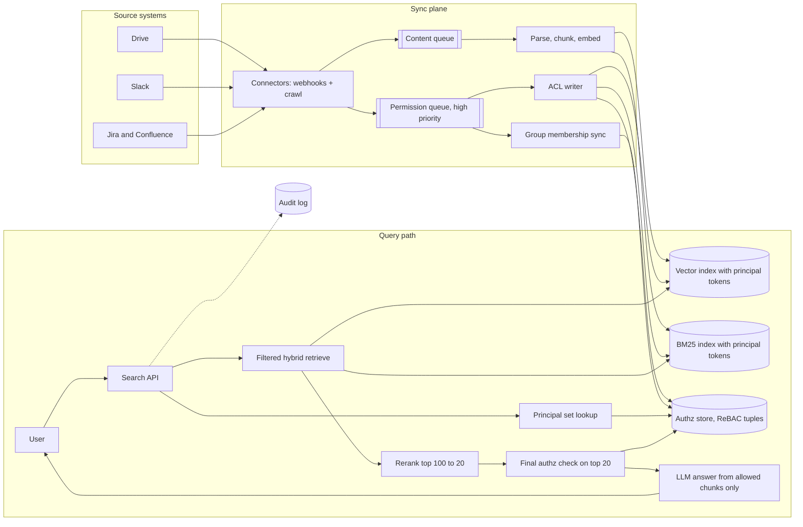

# Design enterprise search with permissions

[All designs](../README.md#the-15-designs) · [Answer framework](../framework.md) · [Numbers to know](../numbers.md)

**Difficulty:** Hard · **Key trade-off:** permission freshness and correctness vs retrieval recall and latency · **Round length:** 45 min

> All numbers here are back-of-envelope estimates with the assumptions written out. Swap in the interviewer's numbers and redo the math out loud. That is the skill being tested.

## Problem statement

"Design a search and AI assistant over a company's Google Drive, Slack, Jira, Confluence and email. Every employee should find anything they are allowed to see, and nothing they are not." (Representative prompt.)

The retrieval half looks like [design 01](01-rag-over-100m-documents.md). The interview is about the second sentence. One leaked HR document or salary spreadsheet ends the product, so permissions are the core of the design, not a filter bolted on at the end. Lead with that and the interviewer knows you have seen the real problem.

## Clarifying questions

| Question | Why it matters | Assumption for this answer |
|---|---|---|
| One company or many tenants? | Isolation model, index layout | Multi-tenant SaaS. Design for one large tenant, then say how tenants are isolated |
| How many employees and items? | Index and ACL size | 100k employees, 200M items across 50 connectors |
| How are permissions expressed in the sources? | Sync model | Per-item ACLs with users, groups, nested groups, "anyone in domain", "anyone with link" |
| How fast must a revoke take effect? | The hardest SLO in the design | Revocations visible within 5 min. Grants within 15 min |
| Do users get answers or just a ranked list? | LLM leakage surface | Both. A ranked list plus a generated answer with citations |
| Can admins see audit logs of who searched what? | Logging and compliance | Yes, per tenant, retained 1 year |
| Can we call source APIs at query time? | Final-check design | Yes, but they are rate limited and slow (100 to 500 ms) |

## Requirements

**Functional**
- Keyword and natural-language search across all connected sources, one ranked list.
- Generated answer grounded only in documents the user can read.
- Results respect the source system's permissions, including group membership and link sharing.
- Admin controls: exclude sources, folders or labels from indexing.

**Non-functional (targets, not measured)**
- Search results p95 under 800 ms. Generated answer first token p95 under 2 s.
- Zero known permission leaks. Fail closed when permission state is unknown.
- Revocation latency p99 under 5 min from source event to search.
- Tenant data isolated at storage, cache and model-context level.

## Back-of-envelope estimates

All estimates.

**Corpus**
1. 200M items. Most are short (Slack messages, Jira comments), some long (docs, PDFs).
2. Assume an average of 1.5 chunks per item: **~300M chunks**.
3. int8 embeddings at 1,024 dims: 300M × 1 KB ≈ **300 GB**, plus ~75 GB HNSW links. Fits in ~6 to 8 shards of 64 GB.

**ACL data**
1. Store principal IDs on each chunk, not expanded user lists. Average 5 principals per item (a few groups plus owners): 300M × 5 × 8 bytes ≈ **12 GB**. Small.
2. If you expanded groups into users, one "all-engineering" group with 30k members on 10M items is 300B entries. This is why you never expand groups at index time.

**User principal set**
1. A user belongs to ~50 to 300 groups after flattening nesting (estimate). That set plus the user ID plus "domain" and "public" tokens is the query-time filter.
2. 100k users × 300 IDs × 8 bytes ≈ **240 MB**. Cache it all in memory.

**Change volume**
1. Content changes: 1% of items per day ≈ 2M/day ≈ **23/s**.
2. Permission changes: assume 1M item ACL changes and 50k group membership changes per day. Group changes are rare but each can affect millions of items, which is why groups stay unexpanded.

**Query load**
1. 100k users × 10 searches/day = 1M/day ≈ **12 QPS** average, ~40 QPS peak during work hours.
2. 30% trigger a generated answer: 300k LLM calls/day × ~5K tokens ≈ **1.5B input tokens/day**, about $225 to $4,500/day at $0.15 to $3 per 1M tokens. Check current pricing.

Load is small. Compute is not the hard part. Correctness is.

## Architecture

## Component walkthrough

**Connectors.** Each source exposes content and permissions differently. Drive has per-file ACLs with inheritance from folders and link sharing. Slack has channel membership, with public channels visible to everyone in the workspace and DMs visible only to participants. Jira has project roles and issue-level security. The connector normalizes all of them into one model: an item has a list of principals (user, group, domain, public-link) that can read it. Use webhooks where sources offer them and a periodic full crawl to repair missed events. Webhooks drop events. Plan for it.

**Two queues, two priorities.** Content changes and permission changes go on separate queues. A permission revoke must not wait behind a backlog of 500k document re-embeds after a big Confluence import. The permission queue has its own workers and its own SLO dashboard.

**Permission model.** Store relationship tuples in a Zanzibar-style authorization store: `doc:123#viewer@group:eng`, `group:eng#member@group:eng-platform`, `group:eng-platform#member@user:alice`. Google's Zanzibar paper describes this model and its consistency tricks ([source](https://research.google/pubs/zanzibar-googles-consistent-global-authorization-system/)). OpenFGA and SpiceDB are open-source versions. The store answers two questions: "can Alice read doc 123?" for the final check, and "which groups is Alice in?" for the query-time filter.

**Principal tokens on the index.** Every chunk carries the principal IDs from its item's ACL as a filterable field. At query time, look up the user's flattened principal set from cache and filter retrieval to chunks whose principal list intersects it. This is pre-filtering. Group membership changes then update only the user-to-group table, never the 10M items the group can read.

**Pre-filter vs post-filter.** This is the question the interviewer wants you to raise.
- Post-filtering retrieves top-k with no ACL filter and drops what the user cannot see. If Alice can see 2% of the corpus, you need ~50x more candidates to end with k allowed results. Recall collapses for users with narrow access, and you have scored documents you should not have touched.
- Pre-filtering pushes the ACL predicate into the ANN search. Filtered HNSW works well when the allowed fraction is moderate. When it is tiny (a contractor who sees 0.01%), graph traversal wanders through disallowed nodes and recall drops. Fix this with a selectivity check: if the allowed set is small, skip ANN and brute-force score the allowed chunks directly. Papers like ACORN study predicate-aware graph search ([source](https://arxiv.org/abs/2403.04871)).
- Per-tenant indexes are the outer layer either way. Never mix tenants in one ANN graph.

**Final authorization check.** The index can be minutes stale. Before showing results or sending chunks to the LLM, check the top 20 against the authz store, which the high-priority queue keeps fresher than the index. Anything that fails is dropped. If the authz store is unavailable, fail closed and return fewer results with a notice. For the most sensitive sources, you can also call the source API for the top few results, accepting 100 to 500 ms.

**Generation.** The LLM only ever sees chunks that passed the final check. The prompt cache, answer cache and conversation history are all scoped by user, or by a hash of the user's principal set. A cached answer built from HR documents must never serve a user without HR access. Summaries and "related people" features leak in the same way, so they go through the same check.

**Ranking signals.** Enterprise search ranks differently from web search. Recency, the author's closeness to the searcher (same team, frequent collaborator), document popularity inside the company, and source type all matter. Glean-style products build a people and activity graph for this. Mention it, but do not let it take over the round.

**Audit.** Log every query, the result IDs shown and the chunks sent to the LLM, per tenant. When a customer asks "who could have seen this file?", you answer from the log, not from memory.

## Data and eval plan

| Layer | Metric | How you get labels |
|---|---|---|
| Permission correctness | Leak rate (must be 0), over-restriction rate | Synthetic test tenants with known ACL graphs; for each test user, compute the exact allowed set and compare against every result returned |
| Revocation latency | p50/p99 seconds from source event to search drop | Canary documents: a job shares and revokes a doc every minute and searches for it |
| Retrieval | Recall@20, nDCG@10 per user access level | Labeled queries run as users with broad, medium and narrow access |
| Answer | Faithfulness, citation accuracy | LLM-as-judge calibrated on human labels |
| Online | Click-through on top 3, "no results" rate, reformulation rate | Product logs |

The permission test suite is the most valuable asset in the system. Run it on every deploy and gate releases on zero leaks, see [design 08](08-eval-pipeline-and-regression-gating.md). Measure retrieval quality per access level. A system that works for the CEO and returns nothing for interns is broken.

## Trade-offs

| Decision | Option A | Option B | When to pick which |
|---|---|---|---|
| Filtering | Pre-filter in ANN | Post-filter top-k | Pre-filter by default. Post-filter only when nearly everyone sees nearly everything |
| ACL storage | Principal IDs on chunks | Expanded user IDs on chunks | Principal IDs. Expansion explodes on large groups and makes group changes rewrite millions of rows |
| Final check | Own authz store | Live source API | Own store for every result. Source API for top few in high-sensitivity sources |
| Index layout | Index per tenant | Shared index with tenant filter | Per tenant for large customers and any compliance requirement. Shared with strict filters only for many tiny tenants, and still separate encryption keys |
| Unknown permission state | Fail closed | Fail open | Fail closed. Missing results cost a support ticket. A leak costs the customer |
| Consistency | Strong (check source each time) | Bounded staleness | Bounded staleness with a tight revoke SLO. Strong consistency on every query is too slow and source APIs rate limit you |

## Failure modes and mitigations

| Failure | Symptom | Mitigation |
|---|---|---|
| Missed revoke webhook | User still finds a doc they lost access to | Periodic ACL re-crawl, final authz check, canary revoke monitor |
| Unsupported ACL type (e.g. Drive "restricted to domain with link") | Doc visible to wrong set | Map unknown ACL types to "owner only" until supported |
| Group sync lag | New team member cannot find team docs | Separate group-sync SLO, on-demand group refresh at login |
| Leak through cache | User sees answer derived from docs they cannot read | Cache keys include principal set hash, never cache cross-user |
| Leak through LLM | Answer mentions a confidential doc title from training data or memory | No fine-tuning on tenant data without per-tenant models, no cross-user memory |
| Narrow-access users get no results | Filtered HNSW recall collapse | Selectivity check, brute force on small allowed sets |
| Connector outage | Source silently stale | Freshness metric per connector and alert |
| Prompt injection in a shared doc | Assistant follows instructions from a doc it retrieved | Treat retrieved text as data, see [design 09](09-guardrails-and-prompt-injection-defense.md) |

## Scaling to 10x

1M employees across tenants in one cell, 2B items.
- **Cells.** Split tenants into cells, each with its own index, authz store and queues. A noisy tenant's re-index cannot slow another tenant's revokes.
- **Authz store.** Zanzibar-style systems scale reads with caching and replicas. Keep the group-flattening cache per user, invalidated on membership events.
- **Large tenants.** One tenant with 500M items gets dedicated index shards. Shard by item hash inside the tenant.
- **Re-crawl budget.** Full ACL re-crawls are now rate-limited by source APIs. Prioritize by sensitivity (HR, legal, finance folders first) and by staleness.
- **LLM cost.** 15B input tokens/day. Answer only when the query looks like a question, and use a small model for short factual answers.

## What interviewers probe

Representative follow-ups.
- "Alice is removed from a group with access to 5M docs. What happens, and how long until she cannot find them?" (One membership tuple changes. Her cached principal set is invalidated. No document rows change. Seconds to minutes.)
- "Why not just post-filter?" (Recall for narrow-access users and touching data you should not.)
- "How do you test that there are no leaks?" (Synthetic ACL graphs with known answers, a leak suite gating every deploy, canary revokes in production.)
- "The source API is down. Do you serve results?" (Serve from the last known ACL state within the staleness bound, fail closed past it.)
- "A user asks the assistant 'what is my manager's salary?'. Walk me through it." (Retrieval is filtered by principals, so salary docs never reach the model. The answer is "I could not find that.")
- "How do you handle 'anyone with the link' sharing?" (A link-share item is readable by users who have opened the link. Track link-open events as grants, or exclude link-only items from search.)

## Companies that ask this

Representative list. These companies build enterprise search, workplace AI or permission-heavy assistants, so this prompt is on-distribution for their loops. Each guide covers that company's actual rounds.
- [Glean](https://www.landed.jobs/resources/guides/glean-ai-interview-guide?utm_source=github&utm_medium=referral&utm_campaign=github-ai-system-design-interview&utm_content=design-02)
- [Microsoft](https://www.landed.jobs/resources/guides/microsoft-ai-interview-guide?utm_source=github&utm_medium=referral&utm_campaign=github-ai-system-design-interview&utm_content=design-02)
- [Salesforce](https://www.landed.jobs/resources/guides/salesforce-ai-interview-guide?utm_source=github&utm_medium=referral&utm_campaign=github-ai-system-design-interview&utm_content=design-02)
- [Notion](https://www.landed.jobs/resources/guides/notion-ai-interview-guide?utm_source=github&utm_medium=referral&utm_campaign=github-ai-system-design-interview&utm_content=design-02)
- [Writer](https://www.landed.jobs/resources/guides/writer-ai-interview-guide?utm_source=github&utm_medium=referral&utm_campaign=github-ai-system-design-interview&utm_content=design-02)

## Further reading

- [Zanzibar: Google's Consistent, Global Authorization System](https://research.google/pubs/zanzibar-googles-consistent-global-authorization-system/) (USENIX ATC 2019). Relationship tuples, the new-enemy problem and zookies.
- [OpenFGA concepts](https://openfga.dev/docs/fga). An open-source Zanzibar-style store with clear docs on modeling groups and inheritance.
- [ACORN: Performant and Predicate-Agnostic Search Over Vector Embeddings and Structured Data](https://arxiv.org/abs/2403.04871). Why filtered ANN loses recall and one way to fix it.
- [Data, privacy and security for Microsoft 365 Copilot](https://learn.microsoft.com/en-us/copilot/microsoft-365/microsoft-365-copilot-privacy). How a large vendor describes permission-trimmed grounding.

[Back to top](#design-enterprise-search-with-permissions)
