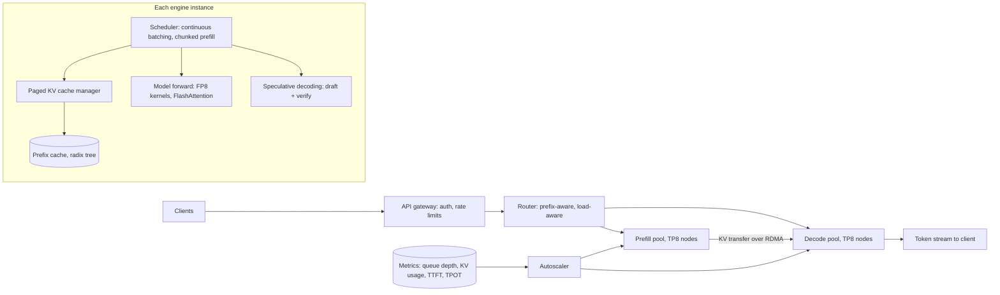

# Design LLM inference serving at scale

[All designs](../README.md#the-15-designs) · [Answer framework](../framework.md) · [Numbers to know](../numbers.md)

**Difficulty:** Hard · **Key trade-off:** throughput (big batches, cheap tokens) vs per-user latency (TTFT and time per output token) · **Round length:** 45 min

> All numbers here are back-of-envelope estimates with the assumptions written out. Swap in the interviewer's numbers and redo the math out loud. That is the skill being tested.

## Problem statement

"Design the serving system for a 70B-parameter open-weights chat model. It should handle 10 million requests a day with streaming responses, at the lowest cost per token that still meets the latency targets." (Representative prompt.)

This is the infra round at model labs and inference providers. The interviewer wants GPU memory math done live, a clear split between prefill and decode, and the scheduler ideas that made modern engines fast: continuous batching, paged KV cache, prefix caching and speculative decoding. If you can explain why decode is memory-bandwidth bound, you are most of the way there.

## Clarifying questions

| Question | Why it matters | Assumption for this answer |
|---|---|---|
| Model architecture? | Weight and KV cache size | 70B dense, 80 layers, GQA with 8 KV heads, head dim 128 (Llama-3-70B-like) |
| Request shape? | Prefill vs decode load | Average 2,000 input tokens, 400 output tokens, max context 32K |
| Latency targets? | Batch size limits | TTFT p50 under 500 ms, p99 under 2 s. Time per output token (TPOT) p99 under 50 ms |
| Hardware? | Memory and bandwidth | H100 80 GB SXM nodes, 8 GPUs per node with NVLink |
| Precision? | Memory and quality | FP8 weights and FP8 KV cache, validated against BF16 on evals |
| Traffic shape? | Autoscaling | Diurnal, peak 3x average |
| Many tenants with shared system prompts? | Prefix cache hit rate | Yes, many requests share long system prompts |

## Requirements

**Functional**
- OpenAI-style chat completions API with streaming.
- Up to 32K context. Stop sequences, sampling parameters, structured output.
- Priority classes: interactive and batch.

**Non-functional (targets, not measured)**
- TTFT p99 under 2 s. TPOT p99 under 50 ms (at least 20 tokens/s per stream).
- 99.9% availability per region.
- Output quality at FP8 within eval noise of BF16.
- Minimize GPU-hours per million tokens.

## Back-of-envelope estimates

All estimates. Memory math first, because it sets everything else.

**Weights**
1. 70B params × 1 byte (FP8) = **70 GB**. At BF16 it would be 140 GB.
2. One H100 has 80 GB. FP8 weights alone nearly fill one GPU, so use tensor parallelism across a node.

**KV cache per token**
1. Formula: 2 (K and V) × layers × KV heads × head dim × bytes per value.
2. BF16: 2 × 80 × 8 × 128 × 2 bytes = 327,680 bytes ≈ **320 KiB per token**.
3. FP8 KV: **160 KiB per token**.
4. Average sequence of 2,400 tokens at FP8: ~375 MiB. A full 32K-token sequence: ~5 GiB.

Without GQA (64 KV heads instead of 8) the KV cache would be 8x larger. That is why GQA exists.

**Load**
1. 10M requests/day ≈ **116 req/s** average, **~350 req/s** peak.
2. Prefill at peak: 350 × 2,000 = **700k input tokens/s**.
3. Decode at peak: 350 × 400 = **140k output tokens/s**.

**Concurrency (Little's law)**
1. At ~25 tokens/s per stream, a 400-token answer takes ~16 s.
2. 350 req/s × 16 s ≈ **5,600 sequences decoding at once** at peak.
3. KV for them: 5,600 × 375 MiB ≈ **2 TB** of HBM across the fleet.

**Decode capacity per node**
1. One decode step reads all weights once: 70 GB over 8 × 3.35 TB/s ≈ 26.8 TB/s aggregate ≈ **2.6 ms** at the roofline.
2. It also reads each active sequence's KV. At batch 256 with 375 MiB each: ~94 GB ≈ another 3.5 ms.
3. Real engines reach a fraction of peak bandwidth, plus all-reduce and kernel overhead. Assume a 20 to 30 ms step at batch ~200 to 250.
4. That gives roughly **7k to 10k output tokens/s per 8-GPU node** at about 35 to 50 tokens/s per stream (estimate, benchmark it).
5. 140k / 7k ≈ **20 decode nodes** (160 GPUs) at peak.

**Prefill capacity**
1. Prefill FLOPs ≈ 2 × params × tokens = 2 × 70e9 × 700k ≈ **9.8e16 FLOP/s**.
2. H100 FP8 dense peak is ~2e15 FLOP/s. At ~40% utilization, ~8e14 per GPU.
3. 9.8e16 / 8e14 ≈ **~120 GPUs** for prefill. Prefix caching that skips half the input tokens cuts this to ~60.

**Fleet and cost**
1. ~180 to 280 GPUs at peak, plus ~30% headroom for failures and spikes: **~250 to 350 H100s**.
2. At $2 to $4 per GPU-hour (estimate, check current pricing), that is **~$12k to $34k/day** for peak-sized capacity. Autoscaling to the diurnal curve recovers maybe a third.

## Architecture

## Component walkthrough

**Prefill vs decode.** Prefill processes the whole prompt in one forward pass. It is compute-bound and fast per token. Decode generates one token per forward pass per sequence. Each step reads every weight and the sequence's KV cache, so it is memory-bandwidth bound. Batching many sequences into one decode step amortizes the weight reads. That single fact explains the whole design: you want large decode batches for cost, and you are limited by KV memory and by TPOT.

**Continuous batching.** Static batching waits for a batch to fill and holds it until the longest sequence ends, wasting slots. Continuous (iteration-level) batching, from the Orca paper ([OSDI 2022](https://www.usenix.org/conference/osdi22/presentation/yu)), rebuilds the batch every step: finished sequences leave, new ones join. Throughput rises several-fold at the same latency.

**Paged KV cache.** Allocating max-context KV per request wastes most of the memory, since most requests are short. PagedAttention stores KV in fixed blocks (e.g. 16 tokens) with a per-sequence block table, like OS virtual memory. The vLLM paper reports near-zero fragmentation and 2x to 4x throughput over prior systems at the same latency ([source](https://arxiv.org/abs/2309.06180)). Blocks also enable sharing: parallel samples and common prefixes point at the same blocks.

**Prefix caching.** Many requests share a long system prompt or a multi-turn history. Keep computed KV blocks in a radix tree keyed by token prefix and reuse them, skipping that part of prefill. SGLang's RadixAttention does this with LRU eviction ([source](https://arxiv.org/abs/2312.07104)). The router must send requests with the same prefix to the same instance or the cache never hits. Route by a hash of the first N tokens, with load-aware spillover.

**Chunked prefill.** A 30K-token prefill in the same step as 200 decodes stalls them all for hundreds of ms, and TPOT p99 explodes. Split long prefills into chunks (e.g. 512 to 2,048 tokens) and mix one chunk per step with the decode batch. This bounds the step time.

**Prefill/decode disaggregation.** Instead of mixing, run separate prefill and decode pools. Prefill nodes compute KV and ship it to a decode node over RDMA. DistServe showed this removes interference and lets you size and parallelize each pool for its own bottleneck ([source](https://arxiv.org/abs/2401.09670)). Cost: KV transfer. 2,000 tokens × 160 KiB ≈ 320 MB per request. At ~50 GB/s that is ~6 ms. Worth it at scale. At small scale, chunked prefill in one pool is simpler.

**Speculative decoding.** A cheap draft (a small model, extra decoding heads, or n-gram lookup) proposes k tokens. The target model verifies all k in one forward pass and accepts the longest correct prefix. With the rejection-sampling scheme from Leviathan et al. the output distribution is identical to the target model's ([source](https://arxiv.org/abs/2211.17192)). It turns spare compute into lower latency, so it helps most at small batch sizes where decode is bandwidth-bound and compute sits idle. At large batches the GPU is busier and gains shrink, so enable it adaptively per load level. EAGLE-style draft heads reach high acceptance rates ([source](https://arxiv.org/abs/2401.15077)).

**Parallelism.** Tensor parallelism (TP) splits each layer's matrices across GPUs and all-reduces per layer. It needs NVLink, so keep TP inside a node (TP8). Pipeline parallelism (PP) splits layers across nodes. It adds pipeline bubbles but uses slower links, so use it when a model does not fit in one node. For MoE models add expert parallelism. For a 70B dense model at FP8, TP4 or TP8 on one node is enough. TP4 gives two replicas per node and more batch per GPU. TP8 gives lower latency per stream. Benchmark both.

**Quantization.** FP8 weights halve memory and bandwidth versus BF16 and use H100 FP8 tensor cores. FP8 KV doubles batch capacity. Validate on your evals: math and code tasks show degradation first. INT4 weight-only quantization helps latency at small batch but hurts at large batch on some kernels.

**Scheduling and preemption.** When KV memory runs out, preempt the lowest-priority sequences: swap their KV to CPU memory or drop it and recompute later. Admission control keeps queue time bounded: reject or shed batch traffic before interactive TTFT breaks.

**Autoscaling.** CPU utilization means nothing here. Scale on queue depth, KV cache utilization and TTFT. Cold start is slow: pulling 70 GB of weights and warming kernels takes minutes. Keep weights on local NVMe or a fast cache, keep a warm pool, and scale ahead of the diurnal curve. Batch traffic absorbs the troughs.

## Data and eval plan

| Layer | Metric | How you get it |
|---|---|---|
| Latency | TTFT and TPOT p50/p99 per input-length bucket | Load tests replaying a recorded request-length distribution |
| Throughput | Output tokens/s per GPU at the latency SLO | Sweep batch size and concurrency, plot the throughput vs latency curve |
| Quality | Eval scores at FP8 vs BF16, with and without speculative decoding | Fixed eval suite. Greedy outputs should match the reference closely, sampled outputs should match on task scores |
| Efficiency | KV utilization, prefix cache hit rate, speculative acceptance rate, MFU | Engine metrics |
| Cost | GPU-hours per 1M tokens, split input and output | Billing and metering |

Every engine upgrade, kernel change or quantization change runs through the quality suite and the load test before rollout. A 5% throughput gain that drops a math benchmark 2 points is a regression. See [design 08](08-eval-pipeline-and-regression-gating.md).

## Trade-offs

| Decision | Option A | Option B | When to pick which |
|---|---|---|---|
| Prefill and decode | Disaggregated pools | Colocated with chunked prefill | Disaggregate at large scale with long prompts. Colocate below ~10 nodes |
| Parallelism | TP8 | TP4 × 2 replicas | TP8 for lowest per-stream latency. TP4 for throughput when the model fits |
| Precision | FP8 | BF16 | FP8 when evals hold. BF16 for quality-critical tenants or before validation |
| Speculative decoding | On | Off | On at low and medium load. Off or shorter drafts at peak batch sizes |
| Batch size | Large | Small | Large for batch and cost-sensitive traffic. Cap for interactive traffic to hold TPOT |
| Prefix routing | Sticky by prefix hash | Pure least-loaded | Sticky when prompts share prefixes, with load-aware overflow to avoid hot spots |

## Failure modes and mitigations

| Failure | Symptom | Mitigation |
|---|---|---|
| Long prompt stalls decodes | TPOT p99 spikes | Chunked prefill or disaggregation, per-request input length limits |
| KV memory exhaustion | Preemption storms, throughput collapse | Admission control, FP8 KV, cap max concurrent long-context sequences |
| Hot prefix | One instance overloaded | Replicate hot prefixes, load-aware spillover in router |
| GPU or NVLink fault | Whole TP group down | Health checks, drain and replace the node, headroom capacity |
| Slow cold start | Queue builds during spike | Warm pool, local weight cache, predictive scaling |
| Quantization regression | Quality drops on some tasks | Eval gate per change, BF16 fallback deployment |
| Retry storm from clients | Load amplification during an incident | Rate limits, retry budgets, `Retry-After` responses |

## Scaling to 10x

100M requests/day, ~1.4M output tokens/s at peak.
- **Fleet.** ~2,500 to 3,500 GPUs. Multiple regions, each a cell with its own router. Global load balancing by region capacity and latency.
- **Disaggregation is mandatory** at this size. Size prefill and decode pools independently from live traffic mix.
- **Prefix cache tiers.** HBM, then CPU memory, then local SSD for KV blocks of popular prefixes. Hit rate is now worth millions of dollars a year.
- **Newer hardware and MoE.** More HBM per GPU raises batch size. An MoE model with fewer active params per token cuts decode cost, with expert parallelism added.
- **Cost per token.** Sell batch tier capacity in troughs. Spot or preemptible capacity for batch only.

## What interviewers probe

Representative follow-ups.
- "Compute the KV cache size for this model at 32K context." (2 × 80 × 8 × 128 × bytes × tokens. Show it.)
- "Why is decode memory-bound and prefill compute-bound?" (Arithmetic intensity: decode does about 2 FLOPs per weight byte read per sequence in the batch.)
- "When does speculative decoding stop helping?" (When batches are large enough that the GPU is compute-bound, and when acceptance rate is low.)
- "TTFT p99 is 8 s during peak. Debug it." (Queue time vs prefill time, long prompts, prefix cache misses, admission control, prefill capacity.)
- "How would you serve 500 fine-tuned variants of this model?" (Multi-LoRA serving, see [design 15](15-fine-tuning-platform-and-lora-serving.md).)
- "How do you pick TP degree?" (Fit, latency target, per-GPU throughput. Benchmark TP4 vs TP8.)

## Companies that ask this

Representative list. These companies build GPUs, inference platforms or model-serving infrastructure, so this prompt is on-distribution for their loops. Each guide covers that company's actual rounds.
- [NVIDIA](https://www.landed.jobs/resources/guides/nvidia-ai-interview-guide?utm_source=github&utm_medium=referral&utm_campaign=github-ai-system-design-interview&utm_content=design-06)
- [Together AI](https://www.landed.jobs/resources/guides/together-ai-ai-interview-guide?utm_source=github&utm_medium=referral&utm_campaign=github-ai-system-design-interview&utm_content=design-06)
- [Fireworks AI](https://www.landed.jobs/resources/guides/fireworks-ai-ai-interview-guide?utm_source=github&utm_medium=referral&utm_campaign=github-ai-system-design-interview&utm_content=design-06)
- [Baseten](https://www.landed.jobs/resources/guides/baseten-ai-interview-guide?utm_source=github&utm_medium=referral&utm_campaign=github-ai-system-design-interview&utm_content=design-06)
- [Groq](https://www.landed.jobs/resources/guides/groq-ai-interview-guide?utm_source=github&utm_medium=referral&utm_campaign=github-ai-system-design-interview&utm_content=design-06)
- [Modal](https://www.landed.jobs/resources/guides/modal-ai-interview-guide?utm_source=github&utm_medium=referral&utm_campaign=github-ai-system-design-interview&utm_content=design-06)
- [Anyscale](https://www.landed.jobs/resources/guides/anyscale-ai-interview-guide?utm_source=github&utm_medium=referral&utm_campaign=github-ai-system-design-interview&utm_content=design-06)

## Further reading

- [Efficient Memory Management for Large Language Model Serving with PagedAttention](https://arxiv.org/abs/2309.06180) (Kwon et al., vLLM). Paged KV cache and its throughput gains.
- [Orca: A Distributed Serving System for Transformer-Based Generative Models](https://www.usenix.org/conference/osdi22/presentation/yu) (OSDI 2022). Iteration-level scheduling, the origin of continuous batching.
- [Fast Inference from Transformers via Speculative Decoding](https://arxiv.org/abs/2211.17192) (Leviathan et al.). Draft and verify with an exact output distribution.
- [DistServe: Disaggregating Prefill and Decoding for Goodput-optimized LLM Serving](https://arxiv.org/abs/2401.09670). Why and how to split prefill and decode.
- [SGLang: Efficient Execution of Structured Language Model Programs](https://arxiv.org/abs/2312.07104). RadixAttention for prefix reuse.

[Back to top](#design-llm-inference-serving-at-scale)
