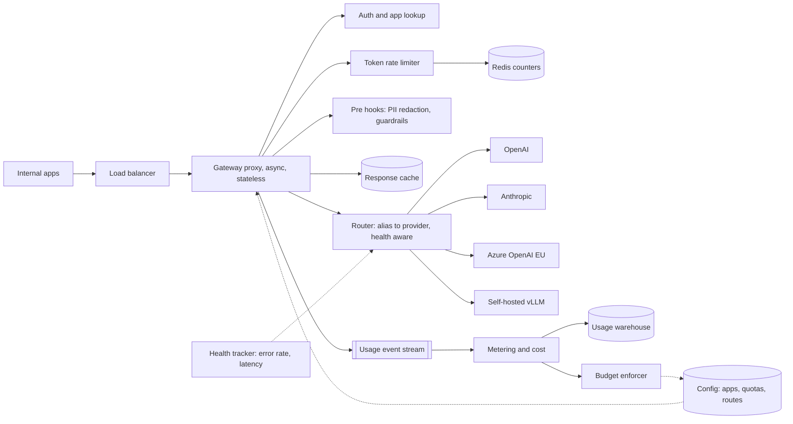

# Design an LLM gateway

[All designs](../README.md#the-15-designs) · [Answer framework](../framework.md) · [Numbers to know](../numbers.md)

**Difficulty:** Medium · **Key trade-off:** added latency and a new single point of failure vs central control of cost, limits and reliability · **Round length:** 45 min

> All numbers here are back-of-envelope estimates with the assumptions written out. Swap in the interviewer's numbers and redo the math out loud. That is the skill being tested.

## Problem statement

"Every team in our company calls OpenAI, Anthropic and a few self-hosted models directly. Design a gateway that all LLM traffic goes through." (Representative prompt.)

This is a classic API gateway question with three twists. Requests are long-lived streams, not 50 ms calls. The unit of cost and rate limiting is the token, not the request. And you do not know the token count of a response until it finishes. Candidates who treat it as "nginx plus an API key check" miss all three. The strong answer is mostly about rate limiting by tokens, fallbacks that do not double your bill, and cost attribution down to the team.

## Clarifying questions

| Question | Why it matters | Assumption for this answer |
|---|---|---|
| How many teams, apps and providers? | Routing table and quota model | 200 internal apps, 4 hosted providers, 2 self-hosted model clusters |
| Request volume and shape? | Capacity of the proxy tier | 50M requests/day, 80% streaming |
| Is the gateway on the latency path for user-facing apps? | Overhead budget | Yes, overhead must be under 20 ms p99 before first token |
| Who pays? Do teams have budgets? | Quota and accounting design | Each team has a monthly budget and per-minute token limits |
| Any data rules? PII, regions? | Redaction hooks, regional routing | EU traffic stays on EU endpoints, PII redaction optional per app |
| Should the gateway cache responses? | Cache layer | Exact-match cache yes, semantic cache opt-in ([design 11](11-semantic-caching.md)) |
| One API shape for all providers? | Translation layer | Yes, an OpenAI-compatible chat API plus native passthrough |

## Requirements

**Functional**
- One endpoint and one credential per app. Provider keys live only in the gateway.
- Route by model alias (for example `fast`, `smart`, `cheap`) to a concrete provider and model.
- Rate limits in requests per minute and tokens per minute, per app and per team. Monthly budgets with alerts and hard stops.
- Fallback to another provider or model on 429, 5xx or timeout.
- Streaming passthrough with no buffering.
- Per-request cost and usage logs, attributed to team, app and user.
- Optional hooks: PII redaction, prompt logging opt-out, guardrails ([design 09](09-guardrails-and-prompt-injection-defense.md)).

**Non-functional (targets, not measured)**
- Added latency under 10 ms p50 and 20 ms p99 before forwarding.
- 99.99% availability for the gateway itself. It cannot be less available than the providers behind it.
- Rate-limit decisions accurate within ~5% under burst.
- Usage data in dashboards within 1 minute. Billing data exact by end of day.

## Back-of-envelope estimates

All estimates.

**Request rate**
1. 50M requests/day / 86,400 ≈ **580 RPS** average. Peak at 3x ≈ **~1,750 RPS**.

**Concurrent streams**
1. Average response streams for ~8 s (400 tokens at ~50 tokens/s).
2. Little's law: 1,750 RPS × 8 s ≈ **14,000 open streams** at peak.
3. Each stream holds two connections (client and upstream) and a small buffer. At ~50 KB of memory per stream (estimate), that is ~700 MB. Connection count, not CPU, sizes the proxy fleet. An async proxy handles 5,000 to 10,000 streams per instance, so 4 to 6 instances plus headroom, say 10 across 2 zones.

**Token volume**
1. Average 2,000 input + 400 output tokens per request.
2. 50M × 2,000 = **100B input tokens/day**, 50M × 400 = **20B output tokens/day**.
3. At a blended $0.5 to $3 per 1M input and $2 to $15 per 1M output, that is roughly **$90k to $600k per day**. Check current pricing. This is why finance wants the gateway.

**Rate-limit store**
1. Every request does at least two counter operations: reserve on start, reconcile on finish.
2. 1,750 RPS × 2 ≈ 3,500 ops/s plus streaming updates. A single Redis primary does 100k+ simple ops/s. One small cluster is plenty, but it is now on the hot path, so you need replicas and a fail-open policy.

**Logs**
1. Metadata per request (IDs, model, tokens, latency, cost) ≈ 1 KB. 50M × 1 KB = **50 GB/day**.
2. Full prompts and responses at ~10 KB each = **500 GB/day**. Store them only for apps that opt in, with a short retention.

## Architecture

## Component walkthrough

**Proxy tier.** Stateless, async (Envoy, Go or Rust services, or a Python async server for low volume). It authenticates the app key, loads app config from a local cache refreshed every few seconds, runs hooks, and forwards. It must stream server-sent events chunk by chunk. Any middleware that buffers the full response breaks time to first token. Keep config local so a config-store outage does not stop traffic.

**Unified API.** Expose one chat schema and translate to each provider. Translation is where bugs hide: tool-call formats, system prompt placement, stop reasons and usage fields differ between providers. Keep a native passthrough route for features the unified schema does not cover yet, or teams will route around you.

**Token rate limiting.** The hard part. You know input tokens before the call (count them with the right tokenizer, or estimate at ~4 characters per token). You do not know output tokens until the stream ends. The standard approach:
1. On request, reserve `input_tokens + max_tokens` from a token bucket for the app and the team.
2. If the bucket lacks capacity, return 429 with `retry-after`.
3. When the stream ends, read the provider's usage field and refund the unused part of the reservation.

Reserving `max_tokens` is conservative. If apps set `max_tokens=4096` and use 300, you throttle them too early. Fix it by reserving a per-app moving average of output tokens and reconciling after, accepting a few percent of overshoot. Use a sliding-window or token-bucket counter in Redis with a Lua script so check and decrement are atomic. Stripe's write-up on layered limiters is a good model ([source](https://stripe.com/blog/rate-limiters)).

You also enforce the provider's limits. Each provider key has its own RPM and TPM. Track them as a separate bucket so one team cannot burn the shared org quota. If you have several keys or deployments for one model, the router spreads load across them.

**Budgets.** Monthly dollar budgets are enforced off the hot path. The metering service sums cost per team every minute and flips a flag in config at 80% (alert) and 100% (block or downgrade to a cheaper model alias). A minute of lag is fine for budgets. It is not fine for rate limits, which is why the two are separate systems.

**Router.** Maps an alias to an ordered list of targets with weights: `smart -> [anthropic/model-x 70%, openai/model-y 30%]`, fallback `[azure-eu/model-y]`. The health tracker keeps a rolling error rate and p95 latency per target and opens a circuit breaker when errors pass a threshold. Region rules filter targets before weighting, so EU apps never fall back to a US endpoint.

**Fallbacks and retries.** Retry only on errors that are safe and likely to succeed elsewhere: 429, 500, 502, 503, connect timeouts. Never retry after the first token has been sent to the client. You cannot un-send tokens, and a second answer would be a different answer. Use exponential backoff with jitter ([AWS Builders' Library](https://aws.amazon.com/builders-library/timeouts-retries-and-backoff-with-jitter/)) and a retry budget, for example retries capped at 10% of traffic, so a provider outage does not triple your load on the remaining providers. Fallback to a different model changes output quality, so the app opts in per alias.

**Caching.** Exact-match cache keyed on a hash of (model, normalized messages, temperature, tools, tenant). Only cache when temperature is 0 or the app opts in. Hit rates for exact match are low for chat (often single-digit percent, estimate) but high for batch jobs that rerun the same prompts. Provider-side prompt caching is a separate thing: the gateway can help by keeping static system prompts byte-identical and at the front. See [design 11](11-semantic-caching.md).

**Hooks.** Pre-request hooks: PII redaction (regex plus an NER model for names and addresses), prompt-injection classifier, blocked-content filter. Post-response hooks: output moderation, PII leak check. Each hook adds latency, so run them in parallel where possible and let apps choose which hooks apply. A 30 ms NER model on every request is acceptable. A 300 ms LLM-judge on every request is not.

**Metering and cost.** Every request emits a usage event: app, team, user ID if passed, model, provider, input tokens, cached input tokens, output tokens, latency, status. A price table, versioned by date, turns tokens into dollars. Write events to a stream (Kafka or Kinesis), aggregate per minute for dashboards, and land raw events in a warehouse for billing. Reconcile monthly with provider invoices. They will differ by a few percent because of tokenizer and caching details.

**Observability.** Per-target dashboards for p50/p99 time to first token, tokens per second, error rate by code, and 429s split into "our limit" vs "provider limit". Teams will blame the gateway for provider slowness. You need the numbers to show where the time went.

## Data and eval plan

A gateway has fewer quality evals than other designs, but it owns the data the other evals use.

| What | Metric | How |
|---|---|---|
| Overhead | Added latency p50/p99 | Timestamps at ingress and at upstream send |
| Rate limiting | Overshoot vs configured TPM, false 429 rate | Compare reserved vs actual tokens per minute |
| Routing | Fallback rate, success after fallback, circuit-breaker opens | Per-target counters |
| Cost | Gateway cost vs provider invoice | Monthly reconciliation, target within 2% |
| Model swaps | Task quality per alias before and after a route change | Each app's eval suite runs against the new target before the route weight moves ([design 08](08-eval-pipeline-and-regression-gating.md)) |
| Logging | Opt-in sampled traces | Feed app-level eval sets and fine-tuning data |

The last two rows matter. Changing the model behind an alias is a product change for every app using it. Treat route changes like deploys: canary 5% of traffic, compare quality and error metrics, then ramp.

## Trade-offs

| Decision | Option A | Option B | When to pick which |
|---|---|---|---|
| Deployment | Central gateway service | Client SDK library in each app | Central for control and key safety. SDK when latency overhead or a new hop is unacceptable, at the cost of weaker enforcement |
| Rate limit reservation | Reserve `max_tokens` | Reserve estimate, reconcile after | Reserve max for strict hard limits. Estimate for better utilization with small overshoot |
| Rate limit store | Central Redis | Local per-instance buckets | Central for accuracy. Local buckets (limit divided by instance count) when you need to survive Redis outages and can accept drift |
| Redis down | Fail open | Fail closed | Fail open for internal traffic, with local fallback limits. Fail closed for external customers on paid tiers |
| Fallback model | Same model, other provider | Different, cheaper model | Same model where available. Different model only if the app opts in and has evals for it |
| Logging prompts | Log everything | Opt-in, sampled | Opt-in. Prompts carry customer data, and storing everything is a liability, not an asset |
| Build vs buy | Build on Envoy or a Go service | LiteLLM, Portkey, Cloudflare AI Gateway | Buy to start. Build when your quotas, routing or compliance rules outgrow the product |

## Failure modes and mitigations

| Failure | Symptom | Mitigation |
|---|---|---|
| Provider outage | 5xx spike for one model | Circuit breaker, fallback route, retry budget |
| Retry storm | Fallback provider gets 3x load and also fails | Retry budget, jittered backoff, shed low-priority traffic first |
| Buffering proxy | Time to first token jumps from 400 ms to 8 s | Streaming tests in CI, alert on TTFT regression |
| Redis outage | All requests 429 or all limits off | Local fallback buckets, fail-open policy with alerting |
| Tokenizer mismatch | Usage counts off by 10%, budget wrong | Use provider usage fields for billing, local counts only for reservation |
| Noisy neighbor | One batch job eats org TPM | Per-team and per-app buckets, priority classes, batch jobs on separate keys |
| Key leak | Provider key in logs or app code | Keys only in gateway secret store, rotate, apps hold gateway keys only |
| Price table stale | Dashboards show wrong spend | Versioned price table, monthly invoice reconciliation |
| Mid-stream upstream drop | Client gets half an answer | Return an error event in the stream, do not silently retry, let the client decide |

## Scaling to 10x

500M requests/day, ~17,500 RPS peak, ~140,000 open streams.
- **Proxy fleet:** scales horizontally. 50 to 100 instances across regions. Put the gateway in each region next to the apps to keep the extra hop under a few ms.
- **Rate limiting:** a single Redis cluster now sees 35,000+ ops/s on the hot path. Shard by app ID. Or move to local token buckets that sync with the central store every 100 ms, trading exactness for availability.
- **Providers:** you now need committed capacity (provisioned throughput, reserved deployments) and a self-hosted tier ([design 06](06-llm-inference-serving.md)) for high-volume, low-complexity traffic. The router starts making cost-based decisions, sending easy requests to small models.
- **Metering:** 500 GB/day of metadata. Pre-aggregate in the stream processor and keep raw events in object storage with a 30-day window.
- **Organization:** the gateway becomes a platform team's product with an SLA. Self-serve config with review, because 2,000 apps cannot file tickets for every quota change.

## What interviewers probe

Representative follow-ups.
- "How do you rate limit by tokens when you do not know the output length?" (Reserve, then reconcile from the usage field. Discuss `max_tokens` vs estimate.)
- "A provider starts returning 529s. What happens to the next 10 seconds of traffic?" (Health tracker trips the breaker, router shifts weight, retry budget caps extra load, in-flight streams are not retried.)
- "Can you retry a streaming request?" (Only before the first token is sent.)
- "How do you attribute cost to an end user inside an app?" (Apps pass a user ID header, the gateway stamps it on usage events.)
- "Where does the gateway add the most latency, and how do you prove it?" (Auth and limit lookups, hooks, TLS to upstream. Ingress and egress timestamps per request.)
- "Why not let every team call the provider directly with their own key?" (No central budget, no fallback, keys scattered, no shared caching, no single place to swap models.)
- "How do you roll out a model change behind the `smart` alias?" (Evals per app, canary weights, compare quality and error metrics, ramp or roll back.)

## Companies that ask this

Representative list. These companies build gateways, developer platforms or high-volume inference APIs, so this prompt is on-distribution for their loops. Each guide covers that company's actual rounds.
- [Portkey](https://www.landed.jobs/resources/guides/portkey-ai-india-ai-interview-guide?utm_source=github&utm_medium=referral&utm_campaign=github-ai-system-design-interview&utm_content=design-07)
- [Vercel](https://www.landed.jobs/resources/guides/vercel-ai-interview-guide?utm_source=github&utm_medium=referral&utm_campaign=github-ai-system-design-interview&utm_content=design-07)
- [Databricks](https://www.landed.jobs/resources/guides/databricks-ai-interview-guide?utm_source=github&utm_medium=referral&utm_campaign=github-ai-system-design-interview&utm_content=design-07)
- [Together AI](https://www.landed.jobs/resources/guides/together-ai-ai-interview-guide?utm_source=github&utm_medium=referral&utm_campaign=github-ai-system-design-interview&utm_content=design-07)
- [Microsoft](https://www.landed.jobs/resources/guides/microsoft-ai-interview-guide?utm_source=github&utm_medium=referral&utm_campaign=github-ai-system-design-interview&utm_content=design-07)

## Further reading

- [Scaling your API with rate limiters](https://stripe.com/blog/rate-limiters) (Stripe). Request limiters, concurrency limiters and load shedding, layered.
- [Timeouts, retries, and backoff with jitter](https://aws.amazon.com/builders-library/timeouts-retries-and-backoff-with-jitter/) (AWS Builders' Library). Retry budgets and why naive retries cause outages.
- [Handling overload](https://sre.google/sre-book/handling-overload/) (Google SRE book). Client-side throttling and criticality classes.
- [LiteLLM router docs](https://docs.litellm.ai/docs/routing). An open-source gateway's routing, fallback and cooldown model.
- [Cloudflare AI Gateway docs](https://developers.cloudflare.com/ai-gateway/). A hosted gateway's feature set: caching, rate limits, logging.

[Back to top](#design-an-llm-gateway)
