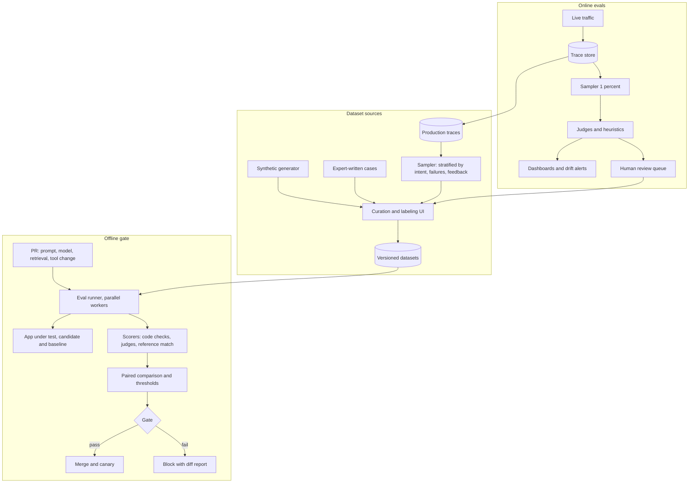

# Design an eval pipeline with regression gating

[All designs](../README.md#the-15-designs) · [Answer framework](../framework.md) · [Numbers to know](../numbers.md)

**Difficulty:** Medium · **Key trade-off:** eval coverage and statistical power vs the cost and time of every run · **Round length:** 45 min

> All numbers here are back-of-envelope estimates with the assumptions written out. Swap in the interviewer's numbers and redo the math out loud. That is the skill being tested.

## Problem statement

"We ship prompt and model changes to an LLM product several times a day and keep breaking things we only hear about from customers. Design an eval system that catches regressions before they ship and tells us how production is doing." (Representative prompt.)

This round has replaced a lot of classic ML system design. The interviewer wants to see that you treat evals as a product with its own data pipeline, not a notebook someone runs before launch. The hard parts are building a test set that matches production, trusting an LLM judge, and deciding when a score drop is real and not noise.

## Clarifying questions

| Question | Why it matters | Assumption for this answer |
|---|---|---|
| What does the product do? | Which metrics make sense | A support assistant with RAG and a few tools (see [design 03](03-customer-support-agent.md)) |
| What changes ship? | What the gate must cover | Prompt edits, model swaps, retrieval config, tool schemas |
| How often? | CI cost and run time budget | ~20 changes/day across 5 teams |
| Do we have labeled data? | Bootstrapping the golden set | Production logs, some thumbs up/down, no gold labels yet |
| Who decides a release ships? | Gate vs advisory | Automatic block on hard failures, human review on soft drops |
| Is there a human review budget? | Judge calibration | ~10 hours/week of domain-expert time |
| Any safety or compliance cases? | Zero-tolerance slices | Yes: PII leaks and refund-policy errors must never regress |

## Requirements

**Functional**
- Versioned eval datasets built from production traces, synthetic cases and expert-written cases.
- Offline runs on every PR that touches prompts, models, retrieval or tools. Results posted on the PR.
- Gate: block merge if a hard check fails or a key metric drops beyond a threshold with statistical confidence.
- Online evals: sample production traces, score them with judges and heuristics, and alert on drift.
- A review queue for humans to label disagreements and calibrate judges.
- Dashboards per slice (intent, language, customer tier).

**Non-functional (targets, not measured)**
- CI eval finishes in under 15 minutes for the standard suite.
- Cost per CI run under ~$20 (estimate), so 20 runs/day stays under ~$400/day.
- Judge agreement with human labels above 85% on calibration sets, measured per metric.
- Online scores visible within 1 hour of traffic.

## Back-of-envelope estimates

All estimates.

**Golden set size and power**
1. Suppose the main metric is a pass rate around 85%.
2. Standard error with n cases is sqrt(p(1 - p) / n). For n = 500: sqrt(0.85 × 0.15 / 500) ≈ 0.016, so a 95% interval is about **±3 points**.
3. That means a 2-point drop on 500 independent cases is noise. Comparing old and new versions on the **same** cases (paired) helps a lot, because most cases pass or fail in both and only the flips count.
4. With a paired test, if ~6% of cases flip, a net shift of 2 points on 1,000 cases is usually detectable. Plan for **1,000 to 2,000 cases** in the main suite and smaller, strict suites for critical slices. The "Adding error bars to evals" paper covers this in depth ([source](https://arxiv.org/abs/2411.00640)).

**CI run cost**
1. 1,500 cases × (1 product call + 3 judge calls).
2. Product call ~3,000 input + 300 output tokens. Judge call ~2,000 input + 200 output.
3. Per run: 1,500 × (3,300 + 3 × 2,200) ≈ **15M tokens**.
4. At $0.5 to $3 per 1M blended tokens, that is **$7 to $45 per run**. Check current pricing. 20 runs/day ≈ $150 to $900/day. Fine, but run the full suite only when relevant files change, and use a smaller smoke suite for the rest.

**CI run time**
1. 1,500 cases with 50 parallel workers, ~6 s per case including judges: 1,500 / 50 × 6 ≈ **3 minutes**. Provider rate limits, not compute, set the real ceiling.

**Online sampling**
1. Production: 1M conversations/day.
2. Sample 1% for LLM-judge scoring = 10,000/day × ~3 judge calls ≈ 30,000 calls ≈ **~70M tokens/day**, roughly $35 to $200/day. Check current pricing.
3. Sample ~50/day for human review. That is about 2 hours of expert time per day at ~2 minutes each, within the budget if you target them well.

## Architecture

## Component walkthrough

**Start from error analysis, not metrics.** Before writing a single judge, read 100 to 200 real traces and write down how they fail. You will find 5 to 10 failure categories: wrong policy cited, refused when it should answer, tool called with a wrong argument, tone, too long. Each category becomes a metric. Generic metrics like "helpfulness 1 to 5" tell you little and move with judge noise. Hamel Husain's write-up makes this case well ([source](https://hamel.dev/blog/posts/evals/)).

**Datasets.** Three sources, all versioned like code:
- Production samples, stratified so rare intents and failures are over-represented. Random sampling gives you 80% easy cases.
- Synthetic cases for coverage: an LLM generates variations by intent, persona and difficulty from a seed list. Humans review a sample. Synthetic data fills gaps; it does not replace real traffic.
- Expert-written cases for critical slices: policy edge cases, adversarial inputs, compliance checks.

Each case has an input (conversation plus context), optional reference answer, slice tags and the checks that apply. Every bug that reaches production becomes a new case. The suite grows from incidents.

**Scorers, cheapest first.**
1. Code checks: JSON schema valid, required tool called, no PII regex match, length limits, citation IDs exist. Deterministic, free, and they catch a lot.
2. Reference-based: exact match or embedding similarity for extraction-style outputs.
3. LLM-as-judge for the rest: one judge per failure category, with a binary or 3-point scale and a rubric. Pairwise judges (A vs B) are more stable than absolute scores for model comparisons, but watch position bias ([Zheng et al.](https://arxiv.org/abs/2306.05685)).

**Judge calibration.** A judge is a model you must evaluate. Label 100 to 200 cases per judge by hand, measure agreement (precision and recall on the "fail" class matter more than raw accuracy), iterate on the rubric, and freeze the judge prompt and model version. Re-run calibration when you change the judge. Known biases to control: position bias (swap order and average), verbosity bias (longer answers score higher), and self-preference (a judge rating its own model family). Use a different model family for judging when you can.

**Runner.** Runs baseline and candidate on the same cases in parallel, with caching keyed on (case, config hash) so unchanged configs do not re-run. Fix temperature and seed where the provider supports it, and run flaky cases 3 times. Agents need trajectory checks as well as final-answer checks: did it call the right tools in a sensible order, and how many steps did it take?

**Statistics and gating.** For each metric and slice, compute the paired difference with a confidence interval (bootstrap over cases, or McNemar's test for binary pass/fail). Gate rules:
- Hard checks (PII leak, schema validity, safety slice): any new failure blocks.
- Key metrics: block if the drop is significant and larger than a set margin, for example 2 points.
- Everything else: report, do not block.

Report case-level diffs: "these 14 cases flipped from pass to fail". Engineers fix what they can read, not a single score.

**Online evals.** Offline sets go stale as users change. Sample live traces, score them with the same judges plus signals you only get online: thumbs down, user rephrases the question, escalation to a human, conversation abandoned. Alert on drops per slice. Feed disagreements and low scores into the human review queue, and from there into the datasets. This loop is the whole system. Without it, the golden set slowly stops representing production.

**Release flow.** Passing the offline gate gets a change to canary, not to everyone. Canary at 5% with online scores and product metrics compared against control, then ramp. Model swaps behind a gateway alias follow the same path ([design 07](07-llm-gateway.md)).

## Data and eval plan

This design is the eval plan, so here is what you measure about the eval system itself.

| Property | Metric | Target (estimate) |
|---|---|---|
| Judge validity | Agreement with human labels per judge | Above 85%, fail-class recall above 80% |
| Set coverage | Share of production intents with at least 30 cases | Above 90% of traffic |
| Gate quality | Regressions caught offline vs found in production | Track every escaped bug, add its case |
| False blocks | Blocked PRs later judged fine | Under 10% |
| Freshness | Age of the newest 20% of cases | Under 30 days |
| Cost | $ per CI run, $ per day online | Within budget above |

## Trade-offs

| Decision | Option A | Option B | When to pick which |
|---|---|---|---|
| Scoring | LLM judge | Code checks and references | Code checks wherever the property is checkable. Judges only for what code cannot check |
| Judge scale | 1 to 10 score | Binary pass/fail per criterion | Binary. Scores drift and nobody agrees what a 7 means |
| Comparison | Absolute scores per version | Pairwise A vs B | Pairwise for model or prompt bake-offs. Absolute for tracking over time |
| Dataset | Real traffic samples | Synthetic | Real first. Synthetic to fill rare slices and for cold start |
| Gate | Hard block | Advisory report | Hard block for safety and schema. Advisory for quality metrics until judges are calibrated |
| Judge model | Frontier model | Small fine-tuned judge | Frontier while rubrics change. Fine-tune a small judge once labels pile up and volume makes cost matter |
| Build vs buy | In-house runner | Eval platforms (Braintrust, Arize, LangSmith, W&B Weave) | Buy for tracing and UI. Keep datasets and judge prompts in your repo either way |

## Failure modes and mitigations

| Failure | Symptom | Mitigation |
|---|---|---|
| Golden set drift | Offline green, users unhappy | Online sampling feeds new cases weekly, track freshness |
| Uncalibrated judge | Scores move when the judge model updates | Pin judge version, recalibrate on change, report agreement |
| Noise read as signal | Teams chase a 1-point drop | Confidence intervals and paired tests on every number |
| Overfitting to the set | Prompt tuned to pass known cases | Hidden holdout set the team cannot see, rotated quarterly |
| Flaky cases | Same config passes then fails | Run 3x, mark flaky, fix or quarantine |
| Slow CI | Engineers skip evals | Smoke suite in 2 minutes, full suite only on relevant paths, result caching |
| Eval cost spike | Bill doubles | Cache by config hash, sample cases for draft PRs |
| Data leakage | PII from traces in eval sets | Redact on ingest, access controls on datasets |

## Scaling to 10x

200 changes/day, 20 product surfaces, 10M conversations/day.
- **Platform:** the runner becomes a shared service with per-team suites, quotas and a dedicated provider key so eval traffic does not hit product rate limits.
- **Judges:** fine-tune small judge models on accumulated human labels. Inference cost drops by an order of magnitude and latency falls enough to score more online traffic.
- **Sampling:** move from uniform 1% to targeted sampling: oversample new intents, low-confidence answers and conversations with negative signals.
- **Human review:** active learning picks the cases where judges disagree with each other or with user signals, so expert hours go where labels change decisions.
- **Governance:** dataset owners per slice, a change log for judge prompts, and a quarterly audit of escaped regressions.

## What interviewers probe

Representative follow-ups.
- "Your judge says the new prompt is 3 points better. Do you ship?" (Check the interval, check paired flips, read the flipped cases, check slices, then canary.)
- "How do you know your LLM judge is right?" (Human-labeled calibration set, agreement per class, bias checks, pinned version.)
- "How big should the golden set be?" (Do the standard error math out loud. Then say paired comparisons need fewer cases.)
- "How do you eval an agent with 15 steps?" (Final outcome, trajectory checks, step count and cost, and pass^k for reliability across repeated runs.)
- "Where does the first version of the dataset come from on day one?" (Error analysis on early traffic or dogfooding, expert-written cases, synthetic fill.)
- "The model provider silently updates the model. How do you notice?" (Pinned versions where possible, scheduled nightly runs on a fixed suite, online drift alerts.)

## Companies that ask this

Representative list. These companies build eval tooling or train and ship models where eval gating is daily work, so this prompt is on-distribution for their loops. Each guide covers that company's actual rounds.
- [Scale AI](https://www.landed.jobs/resources/guides/scale-ai-ai-interview-guide?utm_source=github&utm_medium=referral&utm_campaign=github-ai-system-design-interview&utm_content=design-08)
- [Arize AI](https://www.landed.jobs/resources/guides/arize-ai-ai-interview-guide?utm_source=github&utm_medium=referral&utm_campaign=github-ai-system-design-interview&utm_content=design-08)
- [Weights & Biases](https://www.landed.jobs/resources/guides/weights-biases-ai-interview-guide?utm_source=github&utm_medium=referral&utm_campaign=github-ai-system-design-interview&utm_content=design-08)
- [Anthropic](https://www.landed.jobs/resources/guides/anthropic-ai-interview-guide?utm_source=github&utm_medium=referral&utm_campaign=github-ai-system-design-interview&utm_content=design-08)
- [OpenAI](https://www.landed.jobs/resources/guides/openai-ai-interview-guide?utm_source=github&utm_medium=referral&utm_campaign=github-ai-system-design-interview&utm_content=design-08)
- [Maxim AI](https://www.landed.jobs/resources/guides/maxim-ai-india-ai-interview-guide?utm_source=github&utm_medium=referral&utm_campaign=github-ai-system-design-interview&utm_content=design-08)

## Further reading

- [Your AI product needs evals](https://hamel.dev/blog/posts/evals/) (Hamel Husain). Error analysis first, then unit tests, judges and human review.
- [Judging LLM-as-a-Judge with MT-Bench and Chatbot Arena](https://arxiv.org/abs/2306.05685) (Zheng et al.). Judge agreement with humans and the main biases.
- [Adding Error Bars to Evals](https://arxiv.org/abs/2411.00640) (Miller, Anthropic). Standard errors, clustering and paired comparisons for eval scores.
- [Evaluating the effectiveness of LLM-evaluators](https://eugeneyan.com/writing/llm-evaluators/) (Eugene Yan). A survey of judge methods and where they fail.
- [openai/evals](https://github.com/openai/evals). An open-source eval framework and registry to read for structure.

[Back to top](#design-an-eval-pipeline-with-regression-gating)
