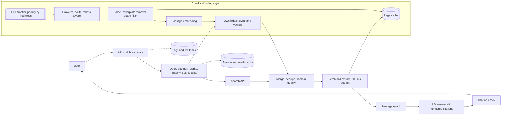

# Design an AI search engine like Perplexity

[All designs](../README.md#the-15-designs) · [Answer framework](../framework.md) · [Numbers to know](../numbers.md)

**Difficulty:** Hard · **Key trade-off:** freshness and coverage of your own index vs cost and dependence on a search API · **Round length:** 45 min

> All numbers here are back-of-envelope estimates with the assumptions written out. Swap in the interviewer's numbers and redo the math out loud. That is the skill being tested.

## Problem statement

"Design an answer engine. A user types a question, and within a couple of seconds gets a streamed answer with numbered citations to web pages." (Representative prompt.)

This looks like [design 01](01-rag-over-100m-documents.md) pointed at the web, and the retrieval core is similar. The differences are what make it a separate round: the corpus is the open web, which is huge, hostile and changes by the minute; latency targets are consumer-grade; and cost per query decides whether the business works. The first big decision is whether to build a web index or call a search API.

## Clarifying questions

| Question | Why it matters | Assumption for this answer |
|---|---|---|
| Query volume? | Serving and cost | 20M queries/day |
| Latency target? | How much retrieval and reranking you can afford | First token under 1.5 s p50, 3 s p95 |
| Freshness? | Crawl design | News within 15 minutes, general pages within days |
| Do we have our own index? | Build vs buy | Start on a search API, grow our own index for top domains |
| Follow-up questions and threads? | Conversation state | Yes |
| Modes: quick answer vs deep research? | Query planning budget | Quick by default, deep mode as a separate, slower product |
| Monetization? | Cost ceiling per query | Free tier with a per-query cost target under $0.01 (estimate) |

## Requirements

**Functional**
- Answer questions with inline numbered citations that link to the source page.
- Show sources before the answer finishes.
- Follow-up questions use thread context.
- Handle fresh queries ("score of last night's game") with recent sources.
- Decline or hedge when sources disagree or are missing.

**Non-functional (targets, not measured)**
- First source cards in under 800 ms p50. First answer token under 1.5 s p50.
- Citation precision above 95%: a cited source supports the sentence.
- Cost per quick query under ~$0.01 at blended rates (estimate).
- 99.9% availability, with graceful degradation if the search backend is slow.

## Back-of-envelope estimates

All estimates.

**Query load**
1. 20M queries/day / 86,400 ≈ **230 QPS** average, **~700 QPS** peak.

**Per-query retrieval**
1. Search returns ~20 results. Fetch and extract ~8 pages (or read them from cache).
2. Each page yields ~1,500 tokens of clean text. Chunk and rerank, keep ~10 snippets of ~300 tokens = **~3,000 tokens** of context.

**Per-query generation**
1. 3,000 context + 500 system and thread = 3,500 input tokens. ~350 output tokens.
2. Daily: 20M × 3,500 = **70B input tokens**, 20M × 350 = **7B output tokens**.
3. Self-hosted mid-size model at an all-in ~$0.1 to $0.3 per 1M tokens: ~$8k to $23k/day. Hosted frontier at $1 to $3 input and $5 to $15 output per 1M: **$100k to $300k/day**. Check current pricing. So the default path uses a fine-tuned mid-size model, and a frontier model is a paid-tier option.

**Search API cost**
1. Third-party web search APIs cost roughly $3 to $15 per 1,000 queries (estimate, check current pricing).
2. 20M × $0.005 = **$100k/day**. That is as large as the generation bill, which is the economic reason to build your own index for the head of the traffic.

**Own index, if you build one**
1. Target 5B pages (a fraction of the crawlable web).
2. ~2 KB of compressed text per page ≈ **10 TB** of text.
3. One 768-dim int8 embedding per passage, ~5 passages per page: 25B × 768 B ≈ **19 TB** of vectors. Plus a BM25 inverted index of a few TB.
4. Crawl rate to refresh 5B pages every 30 days: 5B / 2.6M s ≈ **~1,900 pages/s**, more for news.

**Page fetch at query time**
1. Live fetch of 8 pages adds 300 ms to 2 s with long tails. Cache popular pages and set a hard 600 ms budget for live fetches, using whatever has returned.

## Architecture

## Component walkthrough

**Query planner.** A small, fast model rewrites the query with thread context, classifies it, and decides the plan:
- Navigational ("chase login"): return the link, skip generation.
- Fresh ("news", "today", sports, prices): restrict to recent results, prefer the news index.
- Simple factual: one search, 5 snippets.
- Complex or comparative: 2 to 4 sub-queries in parallel.
- Math, code, weather: route to tools or widgets.

The planner is where you save money. Skipping generation for navigational queries and keeping simple queries to one search cuts the average cost per query sharply.

**Search API vs own index.** Start on a search API: full web coverage on day one, no crawl team. The costs are per-query fees, rate limits, limited control over ranking and snippets, and dependence on a competitor. Build your own index for the head of traffic: popular domains, news, reference sites. A hybrid is the realistic answer: own index first, API for the long tail and as a fallback.

**Crawler.** A URL frontier prioritized by expected change rate and page importance. News sites and sitemaps get polled every few minutes. Respect robots.txt and per-host rate limits. Common Crawl is a free seed for bulk history ([source](https://commoncrawl.org/)), not a fresh index. Parse, remove boilerplate, detect language, filter spam and SEO farms with a quality classifier, and dedupe with shingle hashing.

**Retrieval.** Hybrid, as in design 01: BM25 plus dense vectors, fused. Late-interaction models like ColBERT ([paper](https://arxiv.org/abs/2004.12832)) give better passage ranking than single-vector embeddings at a higher storage cost. Domain quality scores and freshness boosts are features in the ranker. Dedupe syndicated copies of the same article.

**Fetch and extract.** For API results, the snippet is not enough to answer from. Fetch the page, extract main content, and chunk it. Do it in parallel with a hard deadline. Read from the page cache first. Pages behind paywalls or blocked by robots get used only through their snippet.

**Rerank.** A cross-encoder scores ~50 to 100 passages against the query and keeps ~10. Prefer diverse sources: three passages from three outlets beat three from one.

**Generation.** Number the passages [1] to [10] in the prompt and require a citation after each claim. Stream. Send the source cards to the client as soon as the rerank finishes, so the user sees sources at ~800 ms while the answer starts. A model fine-tuned on "answer only from the passages, cite each claim" beats prompting a general model, and it is cheaper to serve. WebGPT showed the pattern of training a model to browse and cite ([paper](https://arxiv.org/abs/2112.09332)).

**Citation check.** For each sentence and its cited passage, a small NLI model checks support. Unsupported sentences get dropped or their citation removed. Run it on streamed sentences with a short lag, or post-hoc with a correction.

**Freshness.** Models answer stale questions with confident old facts. Detect time-sensitive queries, restrict to recent documents, and put the current date in the prompt. FreshLLMs measured how much search augmentation helps on fast-changing questions ([paper](https://arxiv.org/abs/2310.03214)).

**Caching.** Popular queries repeat. Cache search results for minutes (fresh queries) to hours (evergreen), keyed on the normalized query. Cache full answers for evergreen head queries. Cache extracted page text by URL and ETag. See [design 11](11-semantic-caching.md) for the risks of semantic matching.

## Data and eval plan

| Layer | Metric | How you get labels |
|---|---|---|
| Planner | Intent accuracy, sub-query usefulness | Labeled query sample, A/B on answer quality |
| Retrieval | Recall of answer-bearing passages at 10 | Questions with known answers, judged passages |
| Freshness | Accuracy on time-sensitive questions | A rolling set refreshed weekly with recent events |
| Answer | Correctness, completeness | LLM judge calibrated against human graders |
| Citations | Citation precision and recall | NLI plus human spot checks |
| Online | Follow-up rate, source click-through, thumbs, query reformulation | Product logs |

Run a nightly freshness set built from the last 24 hours of news. A search product that is right about last year and wrong about today feels broken.

## Trade-offs

| Decision | Option A | Option B | When to pick which |
|---|---|---|---|
| Index | Third-party search API | Own crawl and index | API to launch. Own index for the head once query volume makes API fees larger than a crawl team |
| Page content | Snippets only | Fetch full pages | Fetch for answer quality. Snippets for latency-critical simple queries |
| Answer model | Frontier hosted | Fine-tuned mid-size self-hosted | Self-hosted for the free tier's cost target. Frontier for paid or complex queries |
| Planning | Single search | Multi-step sub-queries | Single for most queries. Multi-step for comparisons and deep research mode |
| Rerank | Cross-encoder | Embedding similarity only | Cross-encoder. Precision on snippets drives citation quality |
| Citation check | Inline per sentence | Post-hoc | Inline for health, finance, legal queries. Post-hoc elsewhere |

## Failure modes and mitigations

| Failure | Symptom | Mitigation |
|---|---|---|
| SEO spam in sources | Answers cite content farms | Domain quality classifier, source diversity |
| Stale answers | Last year's result for "who won" | Freshness intent detection, recency filter, date in prompt |
| Fetch timeouts | Slow first token | 600 ms budget, page cache, answer from what arrived |
| Citation mismatch | [3] does not say what the sentence claims | NLI check, fine-tuned citing model |
| Prompt injection in pages | Answer follows text hidden in a page | Treat page text as data, strip hidden text, see [design 09](09-guardrails-and-prompt-injection-defense.md) |
| Search API outage | All queries fail | Own index fallback, cached results, degrade to "sources only" |
| Conflicting sources | Confident wrong pick | Prompt to present disagreement, source-quality weighting |
| Publisher blocks | Fewer fetchable pages | Respect robots, use licensed feeds for news |

## Scaling to 10x

200M queries/day, ~7,000 QPS peak.
- **Generation:** 700B input tokens/day. Self-hosting is now mandatory for the free tier. Smaller distilled models, aggressive prompt-prefix caching, and fewer passages per answer ([design 06](06-llm-inference-serving.md)).
- **Index:** own index covers most traffic. The API handles only the long tail. Multi-region replicas of the index near users.
- **Crawl:** tens of thousands of pages/s. Partner feeds for news and licensed content.
- **Caching:** head queries have high repeat rates. A short-TTL answer cache can absorb a large share of traffic (estimate, measure your own repeat rate).
- **Personalization:** with threads and history, retrieval can boost sources the user trusts. Keep it optional and visible.

## What interviewers probe

Representative follow-ups.
- "Build your own index or use Bing/Google APIs? Show the break-even." (API fee per query times volume vs crawl, storage and team cost.)
- "How do you get first token under 1.5 s with page fetches?" (Parallel fetch with deadline, page cache, show sources first, stream.)
- "How do you handle 'what happened today'?" (Freshness classifier, news index, recency filter, date in prompt, fresh eval set.)
- "What is the cost per query, and where does it go?" (Search fees, generation tokens, rerank GPU. Do the math.)
- "How do you know citations are right?" (NLI check, citation precision eval, human audits.)
- "How would you add a deep research mode?" (Agent loop with many searches, a token budget, async delivery, its own eval.)

## Companies that ask this

Representative list. These companies run search or answer products, so this prompt is on-distribution for their loops. Each guide covers that company's actual rounds.
- [Perplexity](https://www.landed.jobs/resources/guides/perplexity-ai-ai-interview-guide?utm_source=github&utm_medium=referral&utm_campaign=github-ai-system-design-interview&utm_content=design-10)
- [Google DeepMind](https://www.landed.jobs/resources/guides/google-deepmind-ai-interview-guide?utm_source=github&utm_medium=referral&utm_campaign=github-ai-system-design-interview&utm_content=design-10)
- [Microsoft](https://www.landed.jobs/resources/guides/microsoft-ai-interview-guide?utm_source=github&utm_medium=referral&utm_campaign=github-ai-system-design-interview&utm_content=design-10)
- [xAI](https://www.landed.jobs/resources/guides/xai-ai-interview-guide?utm_source=github&utm_medium=referral&utm_campaign=github-ai-system-design-interview&utm_content=design-10)

## Further reading

- [WebGPT: Browser-assisted question-answering with human feedback](https://arxiv.org/abs/2112.09332) (Nakano et al., OpenAI). A model that searches, reads and cites.
- [FreshLLMs: Refreshing Large Language Models with Search Engine Augmentation](https://arxiv.org/abs/2310.03214) (Vu et al.). Fast-changing questions and how search helps.
- [ColBERT: Efficient and Effective Passage Search via Contextualized Late Interaction over BERT](https://arxiv.org/abs/2004.12832) (Khattab and Zaharia). Late interaction for passage ranking.
- [Common Crawl](https://commoncrawl.org/). The open web crawl most teams seed from.

[Back to top](#design-an-ai-search-engine-like-perplexity)
