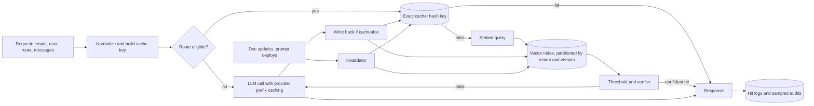

# Design a semantic cache for LLM responses

[All designs](../README.md#the-15-designs) · [Answer framework](../framework.md) · [Numbers to know](../numbers.md)

**Difficulty:** Medium · **Key trade-off:** hit rate vs false hits that serve the wrong answer · **Round length:** 45 min

> All numbers here are back-of-envelope estimates with the assumptions written out. Swap in the interviewer's numbers and redo the math out loud. That is the skill being tested.

## Problem statement

"Our LLM bill is growing faster than usage and a lot of questions look alike. Design a caching layer that cuts cost and latency without hurting answer quality." (Representative prompt.)

Most candidates jump straight to "embed the prompt, find the nearest neighbor, return the cached answer". That is one layer of three, and the riskiest. A good answer separates exact-match response caching, semantic response caching and provider prompt (KV) caching, says which one gives the most savings for this workload, and treats a false hit as a correctness bug with a measurable rate.

## Clarifying questions

| Question | Why it matters | Assumption for this answer |
|---|---|---|
| What is the workload? | Repeat rate and risk of reuse | A customer-facing help assistant for a SaaS product, plus internal batch jobs |
| How many requests and how repetitive? | Expected hit rate | 5M requests/day, many FAQ-style questions |
| Are answers personalized? | Whether reuse is even allowed | Partly: some depend on the user's account |
| Multi-tenant? | Cache isolation | Yes, 2,000 business customers, each with their own docs |
| How fresh must answers be? | TTL and invalidation | Docs change daily, pricing pages change weekly |
| What does a wrong cached answer cost? | Threshold choice | High for billing questions, low for "how do I reset my password" |
| Does the prompt have a large static prefix? | Prompt caching value | Yes, a 3K-token system prompt plus tool definitions |

## Requirements

**Functional**
- Return a cached response for exact repeats of a request.
- Return a cached response for paraphrases when confident it is still correct.
- Never serve one tenant's or user's response to another.
- Invalidate entries when the underlying source docs or prompt version change.
- Per-route opt-in and thresholds. Some routes never use the semantic cache.
- Use provider prompt caching for static prefixes on every call.

**Non-functional (targets, not measured)**
- Cache lookup under 20 ms p99 (embedding + ANN + fetch).
- False hit rate under 0.5% of semantic hits, measured on a labeled sample.
- Overall token spend down 30% or more on eligible routes (estimate, depends on repeat rate).

## Back-of-envelope estimates

All estimates.

**Baseline cost**
1. 5M requests/day. Each: 3,000 static prefix + 1,500 retrieved context + 100 user query = 4,600 input tokens, 300 output.
2. Input: 5M × 4,600 = **23B tokens/day**. Output: 5M × 300 = **1.5B tokens/day**.
3. At $1 per 1M input and $5 per 1M output (illustrative): $23k + $7.5k ≈ **$30k/day**. Check current pricing.

**Provider prompt caching (prefix)**
1. The 3,000-token prefix is identical across calls. Providers price cached input tokens at a large discount, often around 50% to 90% off, with some charging extra to write the cache. Check the docs for each provider ([Anthropic](https://docs.anthropic.com/en/docs/build-with-claude/prompt-caching), [OpenAI](https://cookbook.openai.com/examples/prompt_caching101)).
2. Assume 90% of calls hit the prefix cache at a 75% discount: 5M × 0.9 × 3,000 × 0.75 ≈ 10B token-equivalents saved ≈ **~$10k/day**, about a third of the bill.
3. It also cuts time to first token on long prefixes. And it has zero correctness risk, because the model still runs on the full new input. Do this first.

**Exact-match response cache**
1. Exact repeats after normalization (lowercase, whitespace, same context IDs): assume 5% for chat traffic, 30%+ for batch jobs that rerun.
2. 5% of 5M = 250k skipped calls/day ≈ **$1.5k/day**.

**Semantic response cache**
1. Assume another 15% of queries are paraphrases of a cached question that is still valid. At a strict threshold you capture maybe half: ~7.5%.
2. 375k skipped calls/day ≈ **~$2k/day**, and those users get a ~50 ms answer instead of ~3 s.
3. False hits at 0.5% of 375k = **~1,900 wrong answers/day**. Say this number out loud. It is why the semantic layer is opt-in per route.

**Storage**
1. Keep 30 days of unique entries: ~5M distinct per day at most, realistically ~20M live entries after dedupe and TTL.
2. Each entry: 768-dim float32 embedding (3 KB) + response (~1.5 KB) + metadata ≈ 5 KB. 20M × 5 KB = **100 GB**. One sharded Redis or a vector DB handles it. int8 embeddings bring vectors down to ~15 GB.

**Lookup latency**
1. Embedding the query with a small model: 5 to 15 ms on GPU, or 20 to 50 ms through a hosted API.
2. ANN search in a per-tenant partition: under 5 ms. Fetch: 1 ms.
3. Total ~10 to 25 ms on a miss. That is overhead on every miss, small next to a 2 to 3 s LLM call.

## Architecture

## Component walkthrough

**Three layers, cheapest and safest first.**
1. Provider prompt caching. Order the prompt so static content (system prompt, tool schemas, few-shot examples) comes first and stays byte-identical. Dynamic content goes at the end. One stray timestamp at the top of the system prompt breaks the cache for every call. This layer saves the most for long-prefix workloads and has no correctness risk.
2. Exact-match response cache. Hash of (tenant, user scope, route, prompt version, model, normalized messages, retrieved doc IDs and versions, sampling params). Only for deterministic settings or where any valid answer is fine.
3. Semantic response cache. For paraphrases. This is where the design needs care.

**Cache key and scope.** The key must include everything that changes the right answer. For a RAG route that means the tenant, the user's permission scope (see [design 02](02-enterprise-search-with-permissions.md)), the prompt template version and the model. If an answer used the user's account data, scope it to that user or do not cache it. Leaking one tenant's cached answer to another is a security incident, not a quality bug. Partition the vector index by tenant so a nearest-neighbor search cannot cross tenants even if a filter has a bug.

**What to embed.** Embed the standalone question, not the whole conversation. For follow-ups ("and for the annual plan?") rewrite the question with context first, or skip the semantic cache for multi-turn requests. Most false hits in practice come from short, context-dependent queries.

**Threshold.** Cosine similarity thresholds are model-specific. A 0.92 on one embedding model is not the same as on another. Pick it from data: label a few thousand query pairs as "same answer" or "different answer", plot precision against threshold, and pick the point that hits your false-hit target. Expect the safe threshold to be high, and expect near-duplicates with different meanings ("cancel my subscription" vs "can't cancel my subscription", "pricing for 10 seats" vs "pricing for 100 seats") to sit above it. Numbers and negations are the classic failures.

**Verifier.** For routes where false hits are expensive, add a second check on candidate hits: a cross-encoder or small LLM that answers "would the cached answer correctly answer the new question?" This costs ~20 to 50 ms and a small model call, still far cheaper than the full generation. It lets you lower the similarity threshold and get more hits safely.

**What to cache.** Cache responses only when:
- The answer did not depend on user-specific data, or the scope is per user.
- The response passed output guardrails and was not a refusal or an error.
- The user did not give it negative feedback.
Cache tool-free answers. Do not cache responses that triggered side effects.

**Invalidation.** TTL alone is too blunt. Store the doc IDs and versions each answer used. When a doc changes, the invalidator deletes entries that cite it (keep a reverse index from doc ID to cache keys). A prompt or model version change invalidates by including the version in the key, so old entries just stop matching and expire. Keep TTLs short for routes about prices, availability or anything time-sensitive.

**Stale-while-revalidate.** For high-traffic FAQ answers, serve the cached answer and refresh it in the background when it nears expiry, so the head of traffic never waits.

**Where it lives.** Usually inside or next to the LLM gateway ([design 07](07-llm-gateway.md)), so every app gets it without code changes, with per-route config. Redis with vector search, a vector DB, or an open-source layer like GPTCache ([repo](https://github.com/zilliztech/GPTCache)) all work at this size.

## Data and eval plan

| Layer | Metric | How you get labels |
|---|---|---|
| Threshold | Precision of "same answer" at each threshold | 2,000 to 5,000 labeled query pairs from logs, labeled by humans or a calibrated judge |
| Semantic hits | False hit rate | Daily sample of 200 hits, judge or human checks cached answer against the new question |
| Coverage | Hit rate per layer and per route | Logs |
| Savings | Tokens and dollars saved, latency saved | Logs times price table |
| Quality | User feedback on cached vs fresh answers | Compare thumbs-down rates, A/B with a holdout |
| Isolation | Cross-tenant hits | Should be zero by construction. Test with planted canary entries |

Run a holdout: 5% of eligible traffic skips the semantic cache. Compare feedback and escalation rates. If cached answers get more thumbs-down, the threshold is too loose.

## Trade-offs

| Decision | Option A | Option B | When to pick which |
|---|---|---|---|
| Layer | Provider prompt caching | Response caching | Prompt caching always for long static prefixes. Response caching only where repeat rate is high and answers are reusable |
| Match | Exact | Semantic | Exact everywhere it is safe. Semantic for FAQ-style routes with low cost of error |
| Threshold | Loose, more hits | Strict, fewer false hits | Strict by default. Loosen only with a verifier |
| Verifier | None | Cross-encoder or small LLM check | Add when false hits are costly or you need a lower threshold |
| Scope | Global per tenant | Per user | Per user for anything touching account data. Per tenant for docs-only answers |
| Invalidation | TTL only | Dependency tracking by doc ID | Dependency tracking for RAG routes. TTL for generic content |
| Personalized routes | Cache | Skip | Skip unless the cache key includes the user |

## Failure modes and mitigations

| Failure | Symptom | Mitigation |
|---|---|---|
| False hit on near-duplicate | "100 seats" gets the "10 seats" price | Strict threshold, verifier, number and negation checks, exclude pricing routes |
| Cross-tenant leak | Customer sees another company's data | Tenant partitioned index, scope in key, canary tests |
| Stale answer | Old policy served after update | Doc-dependency invalidation, short TTL on volatile routes |
| Prefix cache misses | Bill does not drop | Keep prefix byte-identical, move dynamic fields to the end, monitor cached-token counts |
| Cache poisoning | One bad answer served thousands of times | Only cache answers that passed guardrails, evict on negative feedback, cap hits per entry before re-check |
| Context-dependent follow-ups | Wrong answer to "what about that one?" | Rewrite to standalone or skip semantic cache in multi-turn |
| Embedding model change | Hit rate falls to zero or false hits rise | Version the embedding model in the index, rebuild, recalibrate threshold |

## Scaling to 10x

50M requests/day, 20,000 tenants.
- **Index:** ~200M live entries. Partition per tenant and shard large tenants. Small tenants share shards with a tenant filter plus key scoping.
- **Embedding:** self-host the query embedder to keep lookup under 15 ms and cost flat.
- **Warmup:** precompute answers for the top FAQ questions per tenant after each doc update, so the head of traffic is always a hit.
- **Verifier cost:** at high hit volume, the verifier becomes a real GPU bill. Distill it to a small cross-encoder.
- **Prompt caching at scale:** route requests with the same prefix to the same model replicas (prefix-aware routing) so self-hosted KV prefix caches stay warm ([design 06](06-llm-inference-serving.md)).

## What interviewers probe

Representative follow-ups.
- "What similarity threshold would you use?" (Refuse to pick a number without data. Describe the labeled-pairs method.)
- "Give me an example of a dangerous false hit." (Numbers, negations, entity swaps, follow-ups that depend on context.)
- "How is this different from prompt caching at the provider?" (KV prefix reuse inside the model run vs skipping the model run. Different risk, different savings.)
- "How do you invalidate when a doc changes?" (Store doc IDs per entry, reverse index, delete on change event.)
- "How do you keep tenants isolated?" (Scope in key, partitioned index, canary tests.)
- "How would you measure that the cache is not hurting quality?" (Holdout A/B, sampled audits, feedback comparison.)

## Companies that ask this

Representative list. These companies build caches, gateways or data and AI platforms where response caching is a product feature, so this prompt is on-distribution for their loops. Each guide covers that company's actual rounds.
- [Redis](https://www.landed.jobs/resources/guides/redis-ai-interview-guide?utm_source=github&utm_medium=referral&utm_campaign=github-ai-system-design-interview&utm_content=design-11)
- [Portkey](https://www.landed.jobs/resources/guides/portkey-ai-india-ai-interview-guide?utm_source=github&utm_medium=referral&utm_campaign=github-ai-system-design-interview&utm_content=design-11)
- [Databricks](https://www.landed.jobs/resources/guides/databricks-ai-interview-guide?utm_source=github&utm_medium=referral&utm_campaign=github-ai-system-design-interview&utm_content=design-11)
- [OpenAI](https://www.landed.jobs/resources/guides/openai-ai-interview-guide?utm_source=github&utm_medium=referral&utm_campaign=github-ai-system-design-interview&utm_content=design-11)

## Further reading

- [Prompt caching](https://docs.anthropic.com/en/docs/build-with-claude/prompt-caching) (Anthropic docs). How prefix caching works, its pricing and cache breakpoints.
- [Prompt caching 101](https://cookbook.openai.com/examples/prompt_caching101) (OpenAI Cookbook). Structuring prompts so the prefix cache hits.
- [GPTCache](https://github.com/zilliztech/GPTCache) (Zilliz). An open-source semantic cache with pluggable embedders, stores and similarity evaluators.
- [GPT Semantic Cache: Reducing LLM Costs and Latency via Semantic Embedding Caching](https://arxiv.org/abs/2411.05276) (Regmi and Pun). Measured hit rates and accuracy for a semantic cache.
- [Semantic caching with RedisVL](https://redis.io/docs/latest/develop/ai/redisvl/user_guide/llmcache/) (Redis docs). Thresholds, TTLs and filters in a production store.

[Back to top](#design-a-semantic-cache-for-llm-responses)
