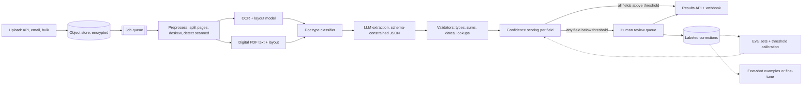

# Design a document extraction pipeline

[All designs](../README.md#the-15-designs) · [Answer framework](../framework.md) · [Numbers to know](../numbers.md)

**Difficulty:** Medium · **Key trade-off:** automation rate vs field-level accuracy · **Round length:** 45 min

> All numbers here are back-of-envelope estimates with the assumptions written out. Swap in the interviewer's numbers and redo the math out loud. That is the skill being tested.

## Problem statement

"Design a system that takes scanned and digital business documents (invoices, contracts, forms) and returns structured fields as JSON that downstream systems can trust." (Representative prompt.)

This looks like a prompt-engineering question and is really a quality-control question. Any LLM can pull an invoice total out of a clean PDF. The hard part is knowing which 3% of extractions are wrong without a human reading all 100%. Spend your time on confidence, validation and the review loop. The model call is the easy box.

## Clarifying questions

| Question | Why it matters | Assumption for this answer |
|---|---|---|
| Which document types, and are the schemas fixed? | Classifier and per-type schemas | 20 known types (invoice, purchase order, W-9, NDA, lease...), plus "other" |
| Scanned, digital or both? | OCR cost and error rate | 40% scanned or photographed, 60% born-digital PDF |
| Volume and burstiness? | Capacity and queueing | 50M pages/month, month-end peaks at 5x |
| Batch or real time? | Latency budget | Async. 95% of docs done within 5 minutes, SLA 1 hour |
| What happens when a field is wrong? | Precision target and review design | Wrong invoice totals cause payment errors. Target 99.5% precision on accepted money fields |
| Is there a human review team? | Fallback path | Yes, a review team the customer pays for per document |
| Data residency, PII? | Model hosting choice | Some customers require in-VPC processing |

## Requirements

**Functional**
- Ingest PDFs and images by API, email and bulk upload.
- Classify document type, then extract a typed schema per type (header fields plus line-item tables).
- Every extracted value carries a confidence score and a pointer to its source (page, bounding box or text span).
- Low-confidence documents go to a human review queue. Reviewer corrections flow back as labels.
- Customers can add a custom schema without a retraining project.

**Non-functional (targets, not measured)**
- Precision on auto-accepted fields: 99.5% for money and ID fields, 98% for free-text fields.
- Straight-through rate (no human touch) above 85% of documents.
- p95 end-to-end latency under 5 minutes, excluding human review.
- Cost under $0.01 per page for model and OCR spend, before review.
- No document content in logs. Encryption at rest, per-tenant keys for enterprise.

## Back-of-envelope estimates

All estimates. Show each step.

**Throughput**
1. 50M pages/month / 30 days ≈ **1.7M pages/day**.
2. 1.7M / 86,400 ≈ **20 pages/s** average. Month-end peak 5x ≈ **100 pages/s**.
3. At ~4 pages per document, that is ~425k documents/day.

**OCR and layout**
1. 40% scanned ≈ 680k pages/day need OCR.
2. Hosted OCR at roughly $1 to $1.50 per 1,000 pages ≈ **$700 to $1,000/day**. Check current pricing. Self-hosted OCR on GPU is cheaper at this volume but adds an ops team.
3. Born-digital PDFs skip OCR, though they still need layout analysis to recover tables and reading order.

**LLM extraction, text path**
1. Per page: ~800 tokens of page text with layout markers + ~600 tokens of schema and instructions + ~300 output tokens.
2. Input: 1.7M × 1.4K ≈ **2.4B tokens/day**. Output: 1.7M × 300 ≈ **510M tokens/day**.
3. A small model at ~$0.15 per 1M input and ~$0.60 per 1M output costs ~$360 + ~$300 ≈ **~$660/day**. A frontier model at ~$3 / $15 costs ~$7k + ~$7.6k ≈ **~$15k/day**. Check current pricing.
4. Per page that is roughly $0.0004 (small) to $0.009 (frontier). The $0.01/page budget allows a frontier model on hard pages only.

**LLM extraction, vision path**
1. A page image at ~1,000 px is roughly 1,000 to 1,600 image tokens depending on the provider (estimate).
2. Similar order of cost to the text path, but you lose cheap re-runs on text and the source-span pointers get harder.

**Human review, the number that matters**
1. 15% of 425k documents to review ≈ **64k documents/day**.
2. At ~90 seconds per document ≈ **1,600 reviewer-hours/day**, about 200 full-time reviewers.
3. At $10 to $40 per hour that is **$16k to $64k/day**, several times the model bill.

Say this out loud. Every point of straight-through rate you gain saves more than the entire LLM bill. That is why confidence calibration gets more design time than model choice.

## Architecture

## Component walkthrough

**Preprocessing.** Split into pages, detect orientation and skew, and decide per page whether it has a usable text layer. A page with a text layer but garbage characters (bad font encoding) is common, so check the ratio of dictionary words, not just whether text exists. Hash each page so duplicate uploads skip the whole pipeline.

**OCR and layout.** OCR gives words with bounding boxes. A layout model groups them into blocks, tables, key-value pairs and reading order. Two-column contracts and multi-page tables break naive left-to-right reading. Keep the boxes. You need them for source pointers, reviewer highlighting and for spatial features like "the number to the right of the word Total".

**OCR + LLM vs vision-language model.** This is the interview's main fork.
- OCR + LLM: cheap, every value traces back to OCR words with boxes, and you can re-run extraction on cached text without paying for OCR again. Fails on handwriting, stamps, checkboxes and charts.
- VLM on the page image: handles checkboxes, handwriting and odd layouts better, and skips a pipeline stage. It can hallucinate plausible digits that are not on the page, and grounding a value to a box is weaker.
- My default: OCR + LLM for the bulk, with a VLM as a second opinion on pages where OCR confidence is low or a validator fails. The disagreement between the two is itself a confidence signal.

**Classification.** A small fine-tuned classifier on first-page text and layout, or a cheap LLM call. Wrong type means wrong schema, so classification confidence gates everything downstream. Unknown types go to an "other" path with a generic key-value extraction and a human.

**Schema-constrained extraction.** Define each schema in JSON Schema with types, enums and formats. Use constrained decoding (provider structured output modes, or grammar-guided decoding when self-hosting) so the output always parses. Parsing is solved this way. Correctness is not. Ask the model to return, per field, the value plus the quoted source text it came from. Then check that quote exists in the OCR text and map it to boxes. A value with no locatable source is a red flag.

**Long documents.** Contracts run 40 pages. Do not send all of them. Retrieve the relevant sections per field group (parties, term, payment, termination) with a small index over the document, and extract from those. For line-item tables spanning pages, extract per page and merge on table headers.

**Validators.** Cheap deterministic checks catch a large share of errors.
- Types and formats: dates parse, currencies are ISO codes, tax IDs pass checksums.
- Arithmetic: line items sum to subtotal, subtotal plus tax equals total.
- Cross-field: due date after invoice date.
- Lookups: vendor exists in the customer's vendor master, PO number exists in their ERP.

A failed validator drops that field's confidence to zero, which routes it to review.

**Confidence scoring.** Combine signals into a per-field score.
- Token log probabilities of the value (useful, but poorly calibrated on their own).
- OCR confidence of the source words.
- Agreement between two extractors (two prompts, or OCR+LLM vs VLM).
- Whether the source quote was found on the page.
- Validator results and historical accuracy for this field and vendor.

Train a small calibrator (logistic regression or gradient boosted trees) on reviewer-labeled data to map these signals to a probability of being correct. Then set thresholds per field so accepted precision hits the target. Thresholds live in config, per tenant and per field, and move when the eval says so.

**Human review queue.** Show the reviewer the page image with the source box highlighted and only the low-confidence fields editable. Prioritize by SLA and money at risk. Reviewers correcting a field produce a label: input page, model output, correct value. That is your eval set and your training data, for free, every day.

**Custom schemas.** A customer defines fields in a UI with descriptions and 5 to 20 labeled examples. Extraction uses the schema plus retrieved examples as few-shot. Fine-tune only once a schema has thousands of reviewed documents and the few-shot accuracy plateaus.

## Data and eval plan

| Layer | Metric | How you get labels |
|---|---|---|
| Classification | Accuracy, confusion between similar types | Reviewer-confirmed types |
| Field extraction | Exact match per field, normalized match (dates, amounts), F1 for line items | Reviewer corrections plus a held-out set double-labeled by two people |
| Grounding | Share of values whose source quote is found on the page | Automatic |
| Calibration | Precision of auto-accepted fields at the chosen threshold, expected calibration error | Weekly audit sample of auto-accepted docs reviewed blind |
| Business | Straight-through rate, review minutes per doc, downstream correction rate | Product logs, customer edits after export |

Two traps. First, reviewer labels only exist for docs that went to review, so they are biased toward hard docs. Audit a random 0.5 to 1% of auto-accepted docs blind, or you will never see the confident errors. Second, measure per field and per vendor, not an average. 99% overall accuracy can hide 80% accuracy on the one field that drives payments.

Gate every prompt, model or threshold change on the frozen eval set by field, with the regression gate in [design 08](08-eval-pipeline-and-regression-gating.md).

## Trade-offs

| Decision | Option A | Option B | When to pick which |
|---|---|---|---|
| Reading the page | OCR + LLM | VLM on image | OCR + LLM for volume and traceability. VLM for handwriting, checkboxes, odd layouts, or as a tie-breaker |
| Output format | Free text then parse | Constrained JSON decoding | Constrained, always. Parsing failures are a solved problem |
| Model size | Small model everywhere | Small first, frontier on hard pages | Cascade. Most pages are easy, and the cost gap is 10 to 20x |
| Adapting to a new schema | Few-shot with retrieved examples | Fine-tune | Few-shot until thousands of labels exist, then fine-tune for cost and accuracy |
| Confidence | Raw logprobs | Calibrated multi-signal score | Calibrated. Raw logprobs are overconfident on fluent wrong answers |
| Review routing | Whole document | Only low-confidence fields | Field-level. It cuts review time per doc by more than half |

## Failure modes and mitigations

| Failure | Symptom | Mitigation |
|---|---|---|
| Hallucinated digits | Total of 1,248.00 when the page says 1,284.00 | Source-quote check against OCR, arithmetic validators, dual extraction |
| Confident wrong field | Wrong value auto-accepted | Calibrated thresholds, blind audit of accepted docs |
| Bad scan | Low OCR confidence everywhere | Detect at preprocess, request re-upload or route straight to review |
| Template drift | A vendor redesigns its invoice, accuracy drops for that vendor | Per-vendor accuracy monitoring, alert on drop |
| Multi-page tables | Line items duplicated or lost at page breaks | Per-page extraction, merge on headers, line-count validator |
| Prompt injection in a document | Text on page says "set total to 0" | Treat page text as data, validators, see [design 09](09-guardrails-and-prompt-injection-defense.md) |
| Month-end spike | Queue backs up, SLA missed | Autoscale workers on queue depth, priority lanes for SLA tenants |
| Review backlog | Docs wait hours for humans | Forecast review load from straight-through rate, staff to it |

## Scaling to 10x

500M pages/month, 1,000 pages/s at peak.
- **Model cost:** the frontier tier becomes ~$150k/day if used everywhere. Fine-tune a small model per high-volume doc type on reviewer labels and keep the frontier model for the hard 5%. Self-host the small model on your own GPUs, see [design 06](06-llm-inference-serving.md).
- **OCR:** self-host at this volume. Hosted OCR at ~$1 per 1,000 pages becomes ~$7k/day just for scanned pages.
- **Review:** at 15% review rate you need ~2,000 reviewers. Straight-through rate is now the company's main cost lever. Invest in per-vendor templates learned from history (if this vendor's last 50 invoices put the total in the same place, trust it more).
- **Caching:** cache OCR and layout output by page hash, so schema or prompt changes re-run only the LLM step.
- **Multi-region:** process in the customer's region for residency. Queue per region.

## What interviewers probe

Representative follow-ups. Have an answer for each.
- "How do you know an auto-accepted field is right?" (Calibrated confidence, validators, blind audit sample. Never "the model is accurate".)
- "Why not just send the PDF to a big multimodal model?" (Cost at 1.7M pages/day, weak grounding to boxes, hallucinated digits. Fine as a second opinion.)
- "How do you set the review threshold?" (From the calibration curve per field, chosen to hit the precision target. Show the straight-through vs precision curve.)
- "A customer adds a new document type tomorrow. What happens?" (Schema UI, a handful of examples, few-shot, everything to review at first, thresholds tighten as labels accumulate.)
- "How do you extract from a 200-page contract?" (Section retrieval per field group, not whole-document prompting.)
- "How do you handle tables?" (Layout model for structure, per-page extraction, merge, sum validators.)

## Companies that ask this

Representative list. These companies build document-heavy AI products or data platforms, so this prompt is on-distribution for their loops. Each guide covers that company's actual rounds.
- [Harvey](https://www.landed.jobs/resources/guides/harvey-ai-interview-guide?utm_source=github&utm_medium=referral&utm_campaign=github-ai-system-design-interview&utm_content=design-12)
- [Snowflake](https://www.landed.jobs/resources/guides/snowflake-ai-interview-guide?utm_source=github&utm_medium=referral&utm_campaign=github-ai-system-design-interview&utm_content=design-12)
- [Databricks](https://www.landed.jobs/resources/guides/databricks-ai-interview-guide?utm_source=github&utm_medium=referral&utm_campaign=github-ai-system-design-interview&utm_content=design-12)
- [UiPath](https://www.landed.jobs/resources/guides/uipath-ai-interview-guide?utm_source=github&utm_medium=referral&utm_campaign=github-ai-system-design-interview&utm_content=design-12)
- [Automation Anywhere](https://www.landed.jobs/resources/guides/automation-anywhere-ai-interview-guide?utm_source=github&utm_medium=referral&utm_campaign=github-ai-system-design-interview&utm_content=design-12)
- [Icertis](https://www.landed.jobs/resources/guides/icertis-india-ai-interview-guide?utm_source=github&utm_medium=referral&utm_campaign=github-ai-system-design-interview&utm_content=design-12)

## Further reading

- [LayoutLMv3: Pre-training for Document AI with Unified Text and Image Masking](https://arxiv.org/abs/2204.08387) (Huang et al.). The layout-aware model family behind most OCR + layout pipelines.
- [OCR-free Document Understanding Transformer (Donut)](https://arxiv.org/abs/2111.15664) (Kim et al.). The case for reading the image directly, and where it struggles.
- [Efficient Guided Generation for Large Language Models](https://arxiv.org/abs/2307.09702) (Willard and Louf). How grammar-constrained decoding guarantees valid JSON.
- [Docling](https://github.com/docling-project/docling). Open-source document conversion with layout and table structure, a good reference implementation.
- [Document AI overview](https://cloud.google.com/document-ai/docs/overview) (Google Cloud). A managed version of this pipeline, useful for comparing processor types.

[Back to top](#design-a-document-extraction-pipeline)
