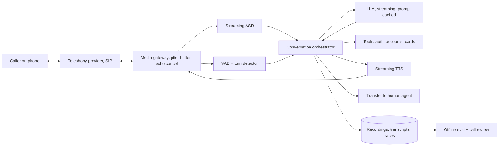

# Design a voice agent with a latency budget

[All designs](../README.md#the-15-designs) · [Answer framework](../framework.md) · [Numbers to know](../numbers.md)

**Difficulty:** Hard · **Key trade-off:** response latency vs turn-taking accuracy · **Round length:** 45 min

> All numbers here are back-of-envelope estimates with the assumptions written out. Swap in the interviewer's numbers and redo the math out loud. That is the skill being tested.

## Problem statement

"Design a voice AI agent that answers phone calls for a bank's customer service line. It should sound natural, handle interruptions and resolve common requests like card freezes and balance questions." (Representative prompt.)

Voice is a text agent with a stopwatch attached. The reasoning and tool calls look like the [customer support agent](03-customer-support-agent.md). What changes is that every component streams, every millisecond is budgeted, and the hardest problem is deciding when the caller has finished talking. Lead with the latency budget. Interviewers want to see you add it up stage by stage.

## Clarifying questions

| Question | Why it matters | Assumption for this answer |
|---|---|---|
| Phone (PSTN) or app/web audio? | Codec quality, network jitter, transport | Phone calls over SIP, 8 kHz audio |
| Concurrent calls at peak? | ASR, LLM and TTS capacity | 10,000 concurrent, ~500k calls/day |
| Average call length? | Cost per call, context growth | 5 minutes, ~20 agent turns |
| Which actions can it take? | Tool design, auth, guardrails | Look up balance, freeze card, update address, transfer to human |
| How does the caller verify identity? | Security before tools run | Account number + one-time code by SMS |
| Languages and accents? | ASR model choice | English and Spanish, wide accent range |
| Recording and compliance rules? | Storage, consent, redaction | Calls recorded with consent, PII redacted in transcripts |

## Requirements

**Functional**
- Answer inbound calls, greet, verify identity, handle the request with tools, confirm actions out loud.
- Handle barge-in: the caller can interrupt and the agent stops talking.
- Transfer to a human with a summary when stuck, when the caller asks, or for high-risk actions.
- Produce a transcript, a summary and the action log per call.

**Non-functional (targets, not measured)**
- Voice-to-voice latency (caller stops speaking to first agent audio) p50 under 800 ms, p95 under 1.2 s.
- Stop agent audio within 200 ms of a real interruption.
- False barge-in (agent stops for "uh-huh" or background noise) under 5% of turns.
- Task completion without transfer above 60% for in-scope intents.
- All-in cost under $0.15 per call minute.
- 99.95% availability. A dead line costs more than a slow one.

## Back-of-envelope estimates

All estimates. Show each step.

**Latency budget, voice to voice**

Human conversation gaps are a few hundred milliseconds. Over about one second, callers start saying "hello?". Here is a budget for a cascaded pipeline.

| Stage | Budget (estimate) | Notes |
|---|---|---|
| Caller audio to our server | 50 to 100 ms | Telephony network and jitter buffer |
| Endpointing (deciding the turn is over) | 200 to 300 ms | The biggest and most tunable number |
| ASR final transcript after endpoint | 50 to 150 ms | Streaming ASR already has the partial |
| LLM time to first token | 200 to 350 ms | Short prompt prefix cached, small or mid model |
| LLM to first speakable phrase | 50 to 100 ms | Wait for ~8 to 15 tokens or a clause boundary |
| TTS time to first audio byte | 75 to 150 ms | Streaming TTS |
| Our server to caller | 50 to 100 ms | Network out |
| **Total** | **~700 to 1,250 ms** | |

The p50 target of 800 ms only works if endpointing and LLM time to first token both sit at the low end. That tells you where design effort goes. Tool calls blow the budget, so they need their own trick (filler speech, below).

**Capacity**
1. 500k calls/day × 5 min = 2.5M call-minutes/day.
2. 10,000 concurrent streams at peak for ASR, LLM sessions and TTS.
3. Streaming ASR on GPU: assume ~100 concurrent streams per GPU (estimate, varies by model) ≈ **100 GPUs** at peak plus headroom.

**LLM tokens**
1. Each turn resends the conversation: ~1.5K system prompt and tools + growing history. Average ~3.5K input tokens per turn, ~60 output tokens (spoken answers are short).
2. 20 turns × 3.5K = **70K input tokens per call**. 500k calls ≈ **35B input tokens/day**.
3. Most of that is the repeated prefix. Prompt caching cuts the input cost by a large factor and cuts time to first token. Without it, voice at this scale is expensive and slow.

**Cost per minute (estimates, check current pricing)**

| Component | Rough cost per minute |
|---|---|
| Telephony (PSTN inbound) | $0.005 to $0.02 |
| Streaming ASR | $0.004 to $0.02 |
| LLM with prompt caching | $0.005 to $0.03 |
| TTS (agent speaks ~40% of the call) | $0.02 to $0.10 |
| **Total** | **~$0.03 to $0.17** |

TTS is often the largest line. Shorter answers save money and latency at the same time.

## Architecture

## Component walkthrough

**Telephony and media gateway.** The telephony provider terminates the phone call and streams audio to you over SIP or a WebSocket media stream, usually 8 kHz mu-law. The media gateway runs a jitter buffer, acoustic echo cancellation (so the agent does not hear itself through a speakerphone and interrupt itself) and resampling. Keep one gateway instance per call pinned for the call's life. Calls are long-lived stateful sessions, so deploys need connection draining, not hard restarts.

**Voice activity detection.** A small VAD model (Silero-class, runs on CPU in a few ms per frame) marks speech vs silence on 20 to 30 ms frames. It drives two decisions: is the caller speaking (barge-in) and has the caller stopped (end of turn).

**Endpointing.** The hardest problem in the design. A fixed silence timeout fails both ways. Set 300 ms and the agent cuts off people who pause mid-sentence while reading a card number. Set 1,000 ms and every turn feels slow. Better approaches:
- A semantic turn detector: a small model that reads the partial transcript and predicts whether the utterance is complete. "My card number is 4417" (pause) is incomplete. "I want to freeze my card" is complete.
- Context-aware timeouts: longer silence allowed when the agent just asked for a number or address.
- Speculative start: begin the LLM call on the partial transcript at a short silence, and throw the result away if the caller keeps talking. This trades extra LLM spend for latency.

**Streaming ASR.** Emits partial transcripts every ~100 ms and a final one at endpoint. Use custom vocabulary or keyword boosting for product names. Numbers are where ASR hurts most ("fifteen" vs "fifty"), so read back critical numbers before acting.

**Orchestrator.** Holds call state: verification status, conversation history, what audio has actually been played. It calls the LLM with tools, streams tokens into TTS at clause boundaries, and handles interruptions. This is a state machine wrapped around an LLM, not a free agent. Verification must complete before account tools unlock, and the code enforces that, not the prompt.

**LLM.** Mid-size model, low temperature, short answers. The system prompt asks for spoken style: no lists, no Markdown, no URLs, numbers written as words where it helps TTS. Time to first token matters more than tokens per second, because TTS speaks slower than the model writes. Route through a [gateway](07-llm-gateway.md) with a fast fallback model, since one slow provider call ruins a turn.

**Tool latency and filler.** A card freeze call to a core banking API can take 2 seconds. The orchestrator plays a short filler ("One moment while I pull that up") when a tool call starts and its expected latency exceeds ~500 ms. Prefetch likely data (account summary) right after verification so later turns skip the wait.

**Streaming TTS.** Send text in clause-sized chunks so the first audio arrives fast, but not word by word, or the prosody breaks. Keep a consistent voice. Cache audio for fixed phrases (greeting, verification prompts, fillers) so they cost nothing and start instantly.

**Barge-in.** When VAD detects caller speech while the agent is talking:
1. Wait ~150 to 250 ms of sustained speech, or a classifier says it is not a backchannel ("uh-huh", "right").
2. Stop TTS playback and flush the audio buffer at the gateway.
3. Truncate the agent's last message in history to the words actually played. Otherwise the LLM believes it said things the caller never heard.
4. Treat the new speech as the next user turn.

**Human transfer.** Transfer by SIP to a contact center queue, with a summary and the verification status attached so the human does not re-ask everything.

## Data and eval plan

| Layer | Metric | How you get labels |
|---|---|---|
| ASR | Word error rate, entity error rate on numbers and names | Human-transcribed sample of real calls, sliced by accent and line quality |
| Turn-taking | Premature cutoff rate, false barge-in rate, mean endpoint delay | Labeled call segments, plus automatic detection of the caller re-starting right after the agent speaks |
| Latency | Voice-to-voice p50 and p95, per stage | Per-turn traces with timestamps for each stage |
| Task | Completion without transfer, correct tool calls, confirmation before action | LLM-as-judge on transcripts, calibrated on human review |
| Safety | Actions without verification (target zero), PII in logs | Automatic checks on action logs |
| Business | CSAT, repeat calls within 7 days, average handle time | Post-call survey, CRM |

Build a simulation harness: an LLM plays the caller with a persona and goal, its text goes through TTS with noise and phone-codec degradation, and your full stack answers. Run hundreds of simulated calls on every change. Real call review still catches what simulation misses, so sample real calls weekly. Gate releases with [design 08](08-eval-pipeline-and-regression-gating.md).

## Trade-offs

| Decision | Option A | Option B | When to pick which |
|---|---|---|---|
| Architecture | Cascaded ASR + LLM + TTS | Speech-to-speech model | Cascaded for regulated work: text guardrails, swappable parts, clean transcripts, better tool use. Speech-to-speech for lowest latency and natural prosody where control matters less |
| Endpointing | Silence timeout | Semantic turn detector | Semantic. Timeout only as the fallback |
| LLM size | Small, fast | Large, slower | Small or mid for most turns. Escalate to a larger model only for complex reasoning turns, with filler covering the delay |
| Speculative LLM start | Off | On | On when latency is the top complaint and you can afford ~20 to 40% more LLM calls |
| TTS | Premium expressive voice | Cheaper fast voice | Premium if CSAT is the metric. Fast if cost per minute is |
| Hosting | All hosted APIs | Self-hosted ASR and TTS | Hosted to start. Self-host at high volume, or when audio cannot leave your network |

## Failure modes and mitigations

| Failure | Symptom | Mitigation |
|---|---|---|
| Cut off mid-sentence | Caller pauses while reading digits, agent jumps in | Semantic endpointing, longer timeout after asking for numbers |
| Agent hears itself | Speakerphone echo triggers barge-in | Echo cancellation, ignore input that matches outgoing audio |
| Backchannel interrupts | "Mm-hmm" stops the agent | Minimum speech duration plus backchannel classifier |
| History out of sync | Agent refers to text it never spoke | Truncate history to played audio on barge-in |
| Misheard number | Wrong account or amount | Read back and confirm before any action |
| Slow tool or LLM | Dead air for 3 seconds | Filler phrases, prefetching, gateway fallback to a faster model |
| Social engineering | Caller talks agent into skipping verification | Verification enforced in orchestrator code, not in the prompt. See [design 09](09-guardrails-and-prompt-injection-defense.md) |
| Provider outage | Calls drop or hang | Multi-provider ASR/TTS/LLM with health checks, final fallback is transfer to humans |

## Scaling to 10x

100,000 concurrent calls, 5M calls/day.
- **ASR and TTS:** ~1,000 GPUs of streaming ASR alone at the assumed density. Self-hosting becomes cheaper than per-minute API pricing. Batch streams across GPUs with a scheduler that respects per-stream real-time deadlines.
- **Regions:** run media and inference close to callers. Every cross-region hop adds 50 to 150 ms to a budget that has none to spare.
- **LLM:** prompt caching plus a fine-tuned small model for the top intents. Large model only on escalation.
- **Sessions:** calls are stateful and long. Use consistent routing per call, graceful drain on deploy, and per-region capacity buffers sized for peak plus one zone failure.
- **Cost:** at 25M minutes/day, every $0.01 per minute is $250k per day. Short spoken answers and cached audio for common phrases become finance projects.

## What interviewers probe

Representative follow-ups. Have an answer for each.
- "Walk me through your latency budget. Where does the time go?" (Stage table. Endpointing and LLM time to first token dominate.)
- "How do you know the caller finished speaking?" (VAD plus semantic turn detection plus context-aware timeouts. Explain the failure each way.)
- "What happens when the caller interrupts?" (Stop playback, flush buffer, truncate history to what was played.)
- "Why not use a speech-to-speech model?" (Fair choice for latency. Harder to guardrail, audit and run tools reliably in a bank. Say when you would switch.)
- "How do you test this before launch?" (Simulated callers through TTS with codec noise, per-stage latency traces, then a small live percentage with human monitoring.)
- "A tool call takes 3 seconds. What does the caller hear?" (Filler phrase, then the answer. Prefetch to avoid it next time.)

## Companies that ask this

Representative list. These companies build voice AI or customer-service agents, so this prompt is on-distribution for their loops. Each guide covers that company's actual rounds.
- [ElevenLabs](https://www.landed.jobs/resources/guides/elevenlabs-ai-interview-guide?utm_source=github&utm_medium=referral&utm_campaign=github-ai-system-design-interview&utm_content=design-13)
- [Sierra](https://www.landed.jobs/resources/guides/sierra-ai-interview-guide?utm_source=github&utm_medium=referral&utm_campaign=github-ai-system-design-interview&utm_content=design-13)
- [Decagon](https://www.landed.jobs/resources/guides/decagon-ai-interview-guide?utm_source=github&utm_medium=referral&utm_campaign=github-ai-system-design-interview&utm_content=design-13)
- [Observe.AI](https://www.landed.jobs/resources/guides/observeai-india-ai-interview-guide?utm_source=github&utm_medium=referral&utm_campaign=github-ai-system-design-interview&utm_content=design-13)
- [Uniphore](https://www.landed.jobs/resources/guides/uniphore-india-ai-interview-guide?utm_source=github&utm_medium=referral&utm_campaign=github-ai-system-design-interview&utm_content=design-13)

## Further reading

- [Pipecat](https://github.com/pipecat-ai/pipecat). Open-source framework for streaming voice agents. Reading its pipeline code shows how frames, interruptions and transports fit together.
- [LiveKit Agents docs](https://docs.livekit.io/agents/). Real-time voice agent framework, with turn detection and telephony integration.
- [Silero VAD](https://github.com/snakers4/silero-vad). A small, widely used voice activity detector that runs on CPU.
- [Moshi: a speech-text foundation model for real-time dialogue](https://arxiv.org/abs/2410.00037) (Defossez et al.). The speech-to-speech alternative to a cascade, with full-duplex turn-taking.

[Back to top](#design-a-voice-agent-with-a-latency-budget)
