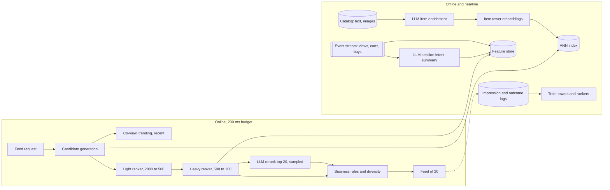

# Design recommendations with LLM reranking

[All designs](../README.md#the-15-designs) · [Answer framework](../framework.md) · [Numbers to know](../numbers.md)

**Difficulty:** Hard · **Key trade-off:** LLM quality gains vs a 200 ms, 15k QPS serving budget · **Round length:** 45 min

> All numbers here are back-of-envelope estimates with the assumptions written out. Swap in the interviewer's numbers and redo the math out loud. That is the skill being tested.

## Problem statement

"Design the home feed recommendations for a large e-commerce app. The team wants to use LLMs to improve relevance. Where do they fit?" (Representative prompt.)

The trap is putting an LLM call on every feed request. At recommender traffic that costs millions per day and blows the latency budget. The strong answer keeps the classic funnel (candidate generation, ranking, re-ranking), then places the LLM where its cost per decision is affordable: offline item and user understanding, nearline session summaries, and an online rerank on a small slice of traffic or a short list. Show the math that forces this.

## Clarifying questions

| Question | Why it matters | Assumption for this answer |
|---|---|---|
| Surface and objective? | What the ranker optimizes | Home feed, maximize purchases with click and add-to-cart as signals |
| Users and traffic? | QPS and cost per request | 50M daily active users, ~500M feed requests/day |
| Catalog size and churn? | Index size, cold start | 50M items, 200k new items/day |
| Latency budget? | How much model fits online | 200 ms p99 server side for the whole feed |
| What signals exist? | Features for retrieval and ranking | Views, clicks, carts, purchases, search queries, item text and images |
| Existing system? | Incremental vs greenfield | A two-tower retrieval and a gradient-boosted ranker already exist |
| Business rules? | Constraints at re-rank | Diversity across categories, no out-of-stock, sponsored slots |

## Requirements

**Functional**
- Return ~20 ranked items per feed request, personalized to user and session.
- Respond to in-session behavior within seconds (just searched for running shoes, feed shifts).
- Handle new users and new items from day one.
- Enforce business rules: stock, diversity, sponsored placement, policy.
- Optionally show a short "because you viewed X" explanation.

**Non-functional (targets, not measured)**
- p99 server latency under 200 ms. Peak ~15k QPS.
- Model serving cost per 1,000 requests under a fixed budget (say $0.05).
- Every model change ships through an A/B test with guardrail metrics.
- Graceful degradation: if any model is down, fall back to the previous stage's ranking, never an empty feed.

## Back-of-envelope estimates

All estimates. Show each step.

**Traffic**
1. 500M requests/day / 86,400 ≈ **5,800 QPS** average. Peak 2.5x ≈ **15k QPS**.

**Why a per-request LLM rerank fails**
1. Listwise rerank of 100 candidates at ~50 tokens per item description = 5K input tokens + ~200 output tokens.
2. 500M × 5K = **2.5T input tokens/day**.
3. Even at $0.10 per 1M input tokens that is **~$250k/day**, ~$90M/year. Check current pricing. Self-hosting changes the constant, not the conclusion.
4. Latency: 5K-token prefill plus 200 decoded tokens on a small model is ~300 ms to 1 s (estimate). The whole budget is 200 ms.

So the LLM cannot sit in the hot path for every request at full list length. Every design choice below follows from this.

**Item embeddings**
1. 50M items × 128-dim float32 = 512 bytes each ≈ **25 GB**. Fits in RAM on one ANN host, replicated for QPS.
2. LLM-enriched item text (attributes, use cases, style): 200k new items/day × ~1K tokens in, ~300 out. ≈ 200M input tokens/day, a few hundred dollars a day at small-model prices. Affordable. The 50M backfill is ~50B tokens, a one-time cost in the $5k to $50k range.

**User session summaries (nearline)**
1. Recompute a short LLM summary of user intent only when the session changes meaningfully, say ~3 times per active user per day.
2. 50M × 3 = 150M calls/day × ~1.5K tokens ≈ **225B tokens/day**. Still large. Restrict to users with enough recent activity, use a small fine-tuned model, and you can cut it 5 to 10x. Present this as the knob.

**Online LLM rerank on a short list, for a slice**
1. Rerank top 20 items with compact descriptions: ~800 input tokens + ~40 output tokens.
2. Run it for 10% of requests (where offline tests say it helps most, for example sparse-history users): 50M × 840 ≈ **42B tokens/day**, on a self-hosted small model.
3. Latency for a small model at ~800 tokens prefill and 40 tokens out is ~80 to 150 ms on a warm GPU (estimate). Tight, which is why it runs in parallel with feature fetch and has a hard timeout.

## Architecture

## Component walkthrough

**Candidate generation.** Several sources, each returning a few hundred items, merged and deduped to ~1,000 to 2,000.
- Two-tower retrieval: a user tower (recent behavior, profile, session intent embedding) and an item tower (item features, enriched text), trained with in-batch negatives on clicks and purchases. Item vectors live in an ANN index. The user vector is computed per request in a few ms.
- Co-visitation ("bought together", "viewed after"), recent views, trending in the user's categories.
- Source diversity matters more than any single source's quality. A ranker cannot rank what retrieval never fetched.

**Light ranker.** A small model (GBDT or tiny MLP) on cheap features scores ~2,000 candidates and keeps ~500. Budget: ~10 to 20 ms.

**Heavy ranker.** A deep model (DLRM-style or a transformer over the user's behavior sequence) with rich features: user-item cross features, price, recency, session embeddings. Multi-task heads predict click, add-to-cart and purchase, combined into one score with tuned weights. Budget: ~40 to 60 ms on CPU or GPU, batched.

**Where LLMs fit.** Four places, cheapest first.
1. **Offline item understanding.** An LLM reads title, description and images and writes normalized attributes, use cases and a dense description. That text feeds the item tower and fixes poor seller-written metadata. This is the highest return per dollar, and it helps cold-start items most.
2. **Nearline session intent.** On meaningful session events (a search, three views in a new category), a small LLM writes a short intent summary ("shopping for trail running shoes, mid-range budget, size 10"). Its embedding becomes a user-tower and ranker feature. Latency does not matter here, it runs in the background.
3. **Distillation.** Use a large LLM offline to judge relevance for millions of (user context, item) pairs. Train the heavy ranker on those labels as an extra objective. The LLM's judgment reaches 100% of traffic at the ranker's cost.
4. **Online rerank of a short list.** A small fine-tuned model reranks the top 20 listwise with the session summary in the prompt. Run it for the slice where offline evaluation shows gains (new users, sparse history, high-intent sessions). Hard timeout at ~120 ms. On timeout, ship the heavy ranker's order.

I would ship 1 and 3 first. They capture most of the gain with no online LLM risk. Option 4 is the one interviewers expect you to argue about, so name its cost per request out loud.

**Business rules and diversity.** Last stage, deterministic. Remove out-of-stock, cap items per category or seller, insert sponsored slots, apply maximal marginal relevance or a determinantal point process for diversity. Rules belong here, not inside the LLM prompt, so they always apply.

**Explanations.** "Because you viewed trail shoes" comes from a template filled with the retrieval source and top feature. An LLM-written explanation is a nice touch for a small slice, but it must not invent reasons the system did not use.

**Feature store and freshness.** The event stream updates real-time features (last 10 views, session category counts) within seconds. Training and serving read the same feature definitions, with point-in-time correct joins for training, or you get training-serving skew.

## Data and eval plan

| Layer | Metric | How you get labels |
|---|---|---|
| Retrieval | Recall@500 of items later engaged with | Logged next-session engagement |
| Ranking | NDCG@20, AUC per task head, calibration | Logged impressions and outcomes, with position bias correction |
| LLM rerank | NDCG lift over heavy ranker on the same lists, per user segment | Offline replay on logged data, then online |
| Item enrichment | Attribute accuracy | Human-graded sample, seller corrections |
| Online | Purchases per session, GMV per user, click-through | A/B test |
| Guardrails | Latency p99, diversity, catalog coverage, return rate, seller concentration | Dashboards per experiment |

Offline metrics on logged data are biased toward what the old system showed. Use inverse propensity weighting or a small randomized exploration slice to get less biased evaluation data. Expect offline gains to shrink online. Ship to an A/B test for at least two weeks to wash out novelty effects, keep a long-term holdout to measure cumulative impact, and use interleaving to compare rankers quickly with less traffic.

## Trade-offs

| Decision | Option A | Option B | When to pick which |
|---|---|---|---|
| LLM placement | Online rerank every request | Offline enrichment + distillation | Offline first. Online only on a sampled slice where the lift pays for the GPUs |
| Rerank style | Pointwise score per item | Listwise rerank of top N | Listwise handles diversity and comparisons, but cost grows with N. Keep N at 20 to 30 |
| Model for online rerank | Hosted frontier API | Self-hosted small fine-tuned model | Self-hosted. Hosted latency variance alone breaks a 200 ms budget |
| Ranker | GBDT | Deep sequence model | GBDT to start or for small teams. Sequence models win when behavior history is long and rich |
| Freshness | Daily batch user features | Streaming session features | Streaming for the feed. Session intent drives most short-term purchases |
| Exploration | Pure exploitation | Small exploration budget | Always keep 1 to 5% exploration, or cold-start items never get data |

## Failure modes and mitigations

| Failure | Symptom | Mitigation |
|---|---|---|
| LLM rerank timeout | p99 spikes, feed slow | Hard timeout, fall back to heavy ranker order, run in parallel |
| Feedback loop | Feed narrows to the same popular items | Exploration slice, diversity rules, coverage guardrail metric |
| Cold-start items never shown | New items get zero impressions | Content-based item tower from LLM-enriched text, exploration boost for new items |
| Cold-start users | Generic feed for new users | Onboarding picks, popular-in-region, fast session intent from the first few actions |
| LLM hallucinated attributes | Item tagged "waterproof" when it is not | Validate against structured catalog fields, human-graded audits, seller correction loop |
| Training-serving skew | Offline gains, online loss | Shared feature definitions, point-in-time joins, log served features |
| Prompt injection via seller text | Item description tries to steer the reranker | Treat item text as data, strip instructions at enrichment, see [design 09](09-guardrails-and-prompt-injection-defense.md) |
| Novelty effect | Week 1 win, week 4 flat | Run tests long enough, long-term holdout |

## Scaling to 10x

5B requests/day, 150k QPS peak, 500M items.
- **Retrieval:** 500M item vectors at 128 dims is ~256 GB float32. Quantize to int8 or PQ and shard the ANN index, or partition retrieval by category and region.
- **Ranking:** GPU-serve the heavy ranker with request batching. Precompute and cache user embeddings per session rather than per request.
- **LLM:** online rerank at 10% of 5B requests is ~420B tokens/day. Shrink the slice, distill harder into the ranker, or cache rerank results per user session for a few minutes. Self-host on dedicated inference GPUs, see [design 06](06-llm-inference-serving.md).
- **Experimentation:** with more traffic, run more concurrent experiments in orthogonal layers. Watch for interactions between ranking tests and UI tests.

## What interviewers probe

Representative follow-ups. Have an answer for each.
- "Why not have the LLM rank the whole feed?" (Token math at 500M requests/day, plus latency. Show the numbers.)
- "How do you know the LLM rerank helps?" (Offline replay NDCG per segment, then A/B on purchases with latency and diversity guardrails.)
- "How do you handle a new item with no interactions?" (Content-based tower from enriched text and images, exploration budget.)
- "What is position bias and how do you correct for it?" (Users click higher items more. Position as a training feature set to a constant at serving, or inverse propensity weights.)
- "How do you get the LLM's quality without its cost?" (Distill LLM relevance labels into the ranker.)
- "What do you do when the rerank model is down?" (Timeout and fall back to the previous stage. Never block the feed.)

## Companies that ask this

Representative list. These companies run large recommender systems and are adding LLMs to them, so this prompt is on-distribution for their loops. Each guide covers that company's actual rounds.
- [Meta](https://www.landed.jobs/resources/guides/meta-ai-interview-guide?utm_source=github&utm_medium=referral&utm_campaign=github-ai-system-design-interview&utm_content=design-14)
- [Amazon](https://www.landed.jobs/resources/guides/amazon-ai-interview-guide?utm_source=github&utm_medium=referral&utm_campaign=github-ai-system-design-interview&utm_content=design-14)
- [Flipkart](https://www.landed.jobs/resources/guides/flipkart-india-ai-interview-guide?utm_source=github&utm_medium=referral&utm_campaign=github-ai-system-design-interview&utm_content=design-14)
- [Swiggy](https://www.landed.jobs/resources/guides/swiggy-india-ai-interview-guide?utm_source=github&utm_medium=referral&utm_campaign=github-ai-system-design-interview&utm_content=design-14)
- [Meesho](https://www.landed.jobs/resources/guides/meesho-india-ai-interview-guide?utm_source=github&utm_medium=referral&utm_campaign=github-ai-system-design-interview&utm_content=design-14)

## Further reading

- [Deep Neural Networks for YouTube Recommendations](https://research.google/pubs/deep-neural-networks-for-youtube-recommendations/) (Covington et al., Google). The candidate generation plus ranking funnel most systems still follow.
- [System Design for Recommendations and Search](https://eugeneyan.com/writing/system-design-for-discovery/) (Eugene Yan). Offline vs online split across many industry systems.
- [Is ChatGPT Good at Search? Investigating Large Language Models as Re-Ranking Agents](https://arxiv.org/abs/2304.09542) (Sun et al.). Listwise LLM reranking and distilling it into small models.
- [Recommender Systems in the Era of Large Language Models](https://arxiv.org/abs/2307.02046) (Zhao et al.). Survey of where LLMs plug into recommenders.

[Back to top](#design-recommendations-with-llm-reranking)
