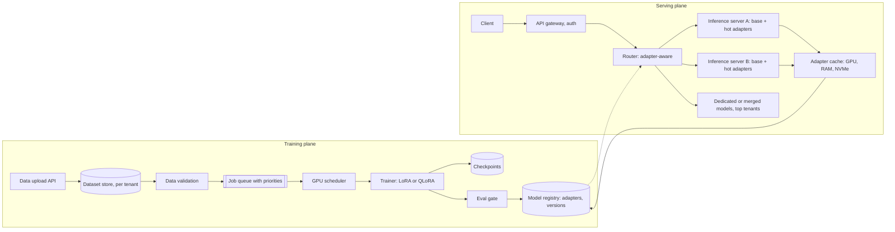

# Design a fine-tuning platform with LoRA serving

[All designs](../README.md#the-15-designs) · [Answer framework](../framework.md) · [Numbers to know](../numbers.md)

**Difficulty:** Hard · **Key trade-off:** per-tenant quality vs GPU cost of serving thousands of variants · **Round length:** 45 min

> All numbers here are back-of-envelope estimates with the assumptions written out. Swap in the interviewer's numbers and redo the math out loud. That is the skill being tested.

## Problem statement

"Design a platform where customers upload data, fine-tune an open-weight model, and get an API endpoint for their fine-tuned model. Thousands of customers, most with low traffic." (Representative prompt.)

Two systems hide in this prompt. One is a batch training platform: validate data, schedule GPU jobs, evaluate, publish. The other is an inference system that serves thousands of model variants without giving each one its own GPU. LoRA is what makes the second one affordable, so the answer turns on adapter math and multi-adapter batching. Most candidates design the training half well and then say "deploy each model to a GPU". At 1,000 mostly idle models, that is the wrong answer by two orders of magnitude.

## Clarifying questions

| Question | Why it matters | Assumption for this answer |
|---|---|---|
| Which base models? | Memory, training cost, serving layout | A few: an 8B and a 70B open-weight model |
| Full fine-tuning or parameter-efficient? | GPU memory and serving density | LoRA by default. Full fine-tune as a premium tier on dedicated GPUs |
| How many customers and jobs? | Scheduler and cluster size | 3,000 active fine-tuned models, ~2,000 training jobs/week |
| Dataset sizes? | Training time | 1k to 100k examples, median ~10k examples of ~1K tokens |
| Traffic per model? | Serving layout | Long tail. Top 50 models take 70% of traffic, most models see under 1 request/minute |
| Latency target for serving? | Batching and cold start | Time to first token p95 under 1 s for warm adapters, under 3 s for cold |
| Isolation and data rules? | Security design | Customer data and adapters never visible across tenants. Option to delete everything |

## Requirements

**Functional**
- Upload training data (chat or completion format), validate it, launch a job with sensible default hyperparameters.
- Report progress, loss curves and an eval report. Customer approves or the platform auto-promotes on passing gates.
- Serve each fine-tuned model behind an OpenAI-compatible endpoint with streaming.
- Version models. Roll back to a previous adapter in one call.
- Delete data, checkpoints and adapters on request.

**Non-functional (targets, not measured)**
- Median LoRA job on the 8B model finishes in under 1 hour from submit.
- Serving: warm adapter time to first token p95 under 1 s. Cold adapter under 3 s.
- GPU utilization above 60% on the serving fleet.
- No cross-tenant leakage of data, adapters or outputs.
- Training jobs survive node failures by resuming from checkpoints.

## Back-of-envelope estimates

All estimates. Show each step.

**LoRA adapter size (8B base, Llama-3-8B-like shapes: 32 layers, hidden 4,096, 8 KV heads of dim 128, MLP 14,336)**

A rank-r adapter on a d_in × d_out matrix adds r × (d_in + d_out) parameters.
1. Attention only, rank 16: q and o add 16 × 8,192 ≈ 131k each, k and v add 16 × (4,096 + 1,024) ≈ 82k each. ≈ 426k per layer × 32 ≈ **13.6M params ≈ 27 MB** in fp16.
2. Adding the three MLP matrices at rank 16: each adds 16 × (4,096 + 14,336) ≈ 295k, so ≈ 885k more per layer. Total ≈ 1.3M per layer × 32 ≈ **42M params ≈ 84 MB**.
3. Compare to the base model: 8B × 2 bytes = **16 GB**. One adapter is ~0.2 to 0.5% of the base.

So 1,000 adapters at ~85 MB is ~85 GB. They fit on one node's NVMe and many fit in GPU memory beside one copy of the base weights. That is the whole economic argument.

**Training memory**
1. Full fine-tune with Adam in mixed precision: roughly 16 bytes per parameter (weights, gradients, two optimizer moments, master copy) ≈ 128 GB for 8B, before activations. Multi-GPU with sharding.
2. LoRA: frozen bf16 base 16 GB + tiny adapter optimizer state + activations. Fits on **one 80 GB GPU**.
3. QLoRA: 4-bit base ≈ 5 GB for 8B, ≈ 35 to 40 GB for 70B. The QLoRA paper fine-tuned a 65B model on a single 48 GB GPU.

**Training time for a median job**
1. 10k examples × 1K tokens × 3 epochs = **30M tokens**.
2. LoRA still runs forward and backward through the frozen base, so roughly 4 × params × tokens FLOPs: 4 × 8e9 × 3e7 ≈ **1e18 FLOPs**.
3. One H100 at ~40% utilization of ~990 dense BF16 TFLOPS ≈ 400 TFLOPS effective.
4. 1e18 / 4e14 ≈ **2,500 s ≈ 40 min**. Plus queueing, data loading and eval. Under one hour is realistic.

**Training cluster**
1. 2,000 jobs/week × ~1 GPU-hour (mixed sizes, 70B jobs take 8 GPUs for longer) ≈ 2,000 to 4,000 GPU-hours/week.
2. That is ~12 to 24 GPUs busy around the clock on average. Size for peaks at ~3x and fill the gaps with preemptible work.

**Serving fleet**
1. Dedicated GPU per model: 3,000 models × at least 1 GPU = **3,000 GPUs**, mostly idle.
2. Multi-LoRA on shared base: total traffic decides GPU count, not model count. If aggregate traffic needs ~60 GPUs of decode throughput, you serve all 3,000 adapters on ~60 to 80 GPUs. Roughly **40x fewer GPUs** (estimate, depends on traffic shape).

**Adapter load time**
1. From GPU-local cache: already resident, near zero.
2. From host RAM over PCIe at ~25 GB/s: 85 MB ≈ **3 to 4 ms**.
3. From local NVMe at ~3 GB/s: ≈ **30 ms**.
4. From object storage: **hundreds of ms to a few seconds**, dominated by the network. Cold start is a download problem.

## Architecture

## Component walkthrough

**Data validation.** Run it before a GPU is touched. It is the cheapest place to stop a bad job.
- Schema and format: valid JSONL, roles alternate correctly, no empty assistant turns.
- Token lengths against the model context. Count truncated examples and warn.
- Exact and near-duplicate removal. Overlap check between training and eval splits, or the eval report lies.
- PII and secrets scan with an option to block or redact. Policy and abuse screen.
- Size check: under ~100 examples, tell the customer prompting or few-shot will likely do as well.

**Job scheduling.** Jobs need 1 to 8 GPUs, run minutes to hours, and are mostly restartable.
- Priority queues by tier, per-tenant quotas so one customer cannot fill the cluster.
- Gang scheduling for multi-GPU jobs (all GPUs or none), placed on one node with NVLink where possible.
- Checkpoint every N minutes to object storage. On node failure or preemption, resume from the last checkpoint.
- Bin-pack small LoRA jobs. A QLoRA job on the 8B model can share a GPU with another via MIG or time-slicing if memory allows.
- Training and serving share hardware only when serving has headroom. Serving always wins a conflict.

**Trainer.** LoRA rank 8 to 64, applied to attention and MLP projections. Defaults from offline sweeps per base model (learning rate, epochs, rank), with early stopping on validation loss. QLoRA for the 70B tier to fit one node. Full fine-tuning as a separate premium path with its own serving story, since full models cannot share a base.

**Eval gate.** Every new adapter runs three suites before promotion.
1. Task eval: the customer's held-out split, scored by exact match, a rubric or a calibrated LLM judge.
2. Baseline comparison: base model with a good prompt on the same set. If the fine-tune does not beat it, say so. Many fine-tunes do not.
3. Regression and safety: a fixed general-capability and safety suite to catch forgetting and safety drift.

Publish the report. Auto-promote only if task score beats baseline and regressions stay within thresholds. The same gating logic as [design 08](08-eval-pipeline-and-regression-gating.md).

**Model registry.** Stores adapter weights, base model ID and version, training config, data hash and eval report. Adapters are tied to an exact base version. Upgrading the base model means retraining adapters, so plan that migration as a product feature.

**Multi-LoRA serving.** One copy of base weights per server. Each request carries an adapter ID. The engine batches requests for different adapters together. The base model matmul runs once for the whole batch. Each request then gets its own low-rank update, computed with gathered kernels like Punica's SGMV that handle many adapters in one batch. S-LoRA adds a unified memory pool that pages both KV cache blocks and adapter weights, so thousands of adapters share GPU memory without fragmentation. vLLM supports serving multiple LoRA adapters on one base model. Per-token overhead of the adapter math is small compared with the base model at typical ranks.

**Adapter cache.** Three tiers: GPU memory (hot, LRU with a slot limit), host RAM (warm), local NVMe (cold). Object storage is the source of truth. Prefetch adapters for tenants with scheduled traffic, and keep each tenant's latest version warm for a few minutes after deploy.

**Adapter-aware routing.** Route requests for an adapter to servers that already have it loaded (consistent hashing on adapter ID, with spillover to other servers under load). This keeps cache hit rates high without pinning. For KV prefix cache reuse, the cache key must include the adapter ID, because the same prompt produces different KV values under different adapters.

**Merged or dedicated deployments.** For the top few tenants with steady high traffic, merge the adapter into the base weights and give them dedicated replicas. No adapter overhead, simpler kernels, predictable latency, and they pay for reserved capacity.

**Isolation.** Per-tenant storage prefixes and encryption keys. The adapter ID in a request is checked against the caller's tenant in the gateway, never trusted from the request alone. Batching different tenants together on one GPU is fine for correctness since adapters apply per request, but say how you would audit it.

## Data and eval plan

| Layer | Metric | How you get labels |
|---|---|---|
| Data validation | Rejection reasons, duplicate rate, train/eval overlap | Automatic |
| Training | Loss curves, job failure rate, time to completion, GPU utilization | Job telemetry |
| Model quality | Task score vs base-with-prompt baseline | Customer held-out split, LLM judge calibrated on human labels |
| Regression | General capability and safety suite deltas | Fixed internal suites |
| Serving | TTFT and tokens/s per adapter, cold-start rate, adapter cache hit rate | Per-request traces |
| Business | Share of fine-tunes that beat baseline, share that get real traffic | Product analytics |

The metric I would watch most is the share of fine-tunes that beat the prompted baseline. If it is low, the platform should steer customers to better data or to prompting, not sell more GPU hours.

## Trade-offs

| Decision | Option A | Option B | When to pick which |
|---|---|---|---|
| Method | LoRA | Full fine-tune | LoRA by default. Full only for large data, big domain shift, and a tenant that pays for dedicated serving |
| Precision in training | LoRA on bf16 base | QLoRA on 4-bit base | QLoRA when the model must fit fewer GPUs. Slightly slower, small quality cost |
| Serving | Unmerged multi-LoRA on shared base | Merged weights, dedicated GPUs | Shared for the long tail. Merged for steady high-traffic tenants |
| Adapter placement | Load on demand | Keep all resident | On demand with LRU and prefetch. All resident only when adapter count is small |
| Rank | Low (8 to 16) | High (64+) | Low for style and format tasks. Higher for knowledge-heavy tasks, but check the eval, rank is not a quality dial past a point |
| Hyperparameters | Customer chooses | Platform defaults with sweeps | Defaults. Most customers lose quality tuning by hand |

## Failure modes and mitigations

| Failure | Symptom | Mitigation |
|---|---|---|
| Garbage training data | Fine-tune worse than base | Validation, baseline comparison in eval report, block promotion |
| Train/eval leakage | Great eval, bad production | Dedupe across splits, customer-visible overlap stats |
| Catastrophic forgetting | Model loses general skills or safety behavior | Regression suite gate, low rank, mix in general data |
| Node failure mid-job | Job restarts from zero | Periodic checkpoints, resume, idempotent job state |
| Cold-start storm | Many idle adapters requested at once, TTFT spikes | Tiered cache, prefetch, NVMe staging, rate-limit cold loads per server |
| Hot adapter | One tenant overloads its servers | Spread across more servers, then move to dedicated merged deployment |
| Base model upgrade | Old adapters incompatible | Pin base version per adapter, offer retrain on new base with eval comparison |
| Wrong adapter served | Tenant gets another tenant's model | Gateway checks adapter ownership, adapter ID in every trace, KV cache keyed by adapter |

## Scaling to 10x

30,000 adapters, 20,000 jobs/week.
- **Training:** 20k to 40k GPU-hours/week, ~120 to 240 GPUs busy on average. Use spot or preemptible capacity with checkpointing for the bulk, reserved capacity for premium tiers.
- **Adapter storage:** 30k × 85 MB ≈ 2.5 TB. Easy in object storage. The NVMe tier holds the warm set per region.
- **Serving:** model count no longer drives cost, traffic does. Cache hit rate does. Shard adapters across server groups by consistent hashing so each group's working set fits its caches.
- **Base models:** more base models fragment the fleet, since an adapter only runs on its base. Limit supported bases and push customers toward the current one.
- **Scheduler:** a single queue becomes a bottleneck. Partition by region and GPU type, with a global quota service.

## What interviewers probe

Representative follow-ups. Have an answer for each.
- "How big is a LoRA adapter for an 8B model? Show me." (r × (d_in + d_out) per matrix, summed over layers. Tens of MB.)
- "How do you serve 3,000 fine-tuned models without 3,000 GPUs?" (Shared base, multi-adapter batching with SGMV-style kernels, paged adapter memory, tiered adapter cache.)
- "What happens on the first request to an adapter nobody has used in a week?" (Download from object store to NVMe to GPU. Seconds. Prefetch and show a cold-start SLA.)
- "When is LoRA the wrong choice?" (Large domain shift with lots of data, or when one tenant has steady high traffic and wants the fastest kernels. Full fine-tune or merge.)
- "How do you know the fine-tune is better than prompting?" (Baseline comparison on the same held-out set. Publish both scores.)
- "A job dies at 90%. What happens?" (Resume from the last checkpoint. Scheduler retries with backoff on a different node.)

## Companies that ask this

Representative list. These companies run fine-tuning and inference platforms, so this prompt is on-distribution for their loops. Each guide covers that company's actual rounds.
- [Together AI](https://www.landed.jobs/resources/guides/together-ai-ai-interview-guide?utm_source=github&utm_medium=referral&utm_campaign=github-ai-system-design-interview&utm_content=design-15)
- [Fireworks AI](https://www.landed.jobs/resources/guides/fireworks-ai-ai-interview-guide?utm_source=github&utm_medium=referral&utm_campaign=github-ai-system-design-interview&utm_content=design-15)
- [Databricks](https://www.landed.jobs/resources/guides/databricks-ai-interview-guide?utm_source=github&utm_medium=referral&utm_campaign=github-ai-system-design-interview&utm_content=design-15)
- [Hugging Face](https://www.landed.jobs/resources/guides/hugging-face-ai-interview-guide?utm_source=github&utm_medium=referral&utm_campaign=github-ai-system-design-interview&utm_content=design-15)
- [Modal](https://www.landed.jobs/resources/guides/modal-ai-interview-guide?utm_source=github&utm_medium=referral&utm_campaign=github-ai-system-design-interview&utm_content=design-15)
- [OpenAI](https://www.landed.jobs/resources/guides/openai-ai-interview-guide?utm_source=github&utm_medium=referral&utm_campaign=github-ai-system-design-interview&utm_content=design-15)

## Further reading

- [LoRA: Low-Rank Adaptation of Large Language Models](https://arxiv.org/abs/2106.09685) (Hu et al.). The method, and why adapters are tiny.
- [QLoRA: Efficient Finetuning of Quantized LLMs](https://arxiv.org/abs/2305.14314) (Dettmers et al.). 4-bit base weights, 65B on one 48 GB GPU.
- [S-LoRA: Serving Thousands of Concurrent LoRA Adapters](https://arxiv.org/abs/2311.03285) (Sheng et al.). Unified paging for adapters and KV cache.
- [Punica: Multi-Tenant LoRA Serving](https://arxiv.org/abs/2310.18547) (Chen et al.). The SGMV kernel that batches requests across adapters.
- [LoRA adapters in vLLM](https://docs.vllm.ai/en/latest/features/lora.html). How a production engine exposes multi-LoRA serving.

[Back to top](#design-a-fine-tuning-platform-with-lora-serving)
